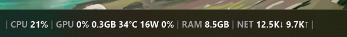
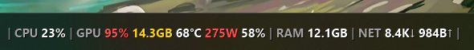
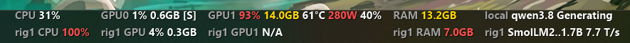
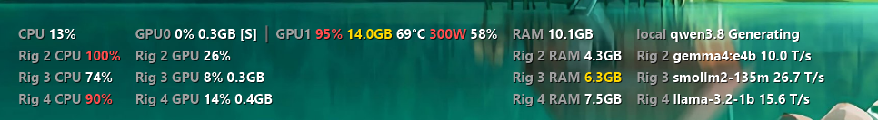

# BareStats

> **An ultra-lightweight, near-zero-overhead native system telemetry overlay for macOS, Linux, and Windows.**

[](https://github.com/chakrank/BareStats/actions/workflows/ci.yml)
[](https://github.com/chakrank/BareStats/releases)
[](https://github.com/chakrank/homebrew-tap)
[](https://pypi.org/project/barestats/)
[](LICENSE)

---

```text
Single-GPU Mode:
│ CPU 12% │ GPU 45% 4.2/16GB 52°C 85W 40% │ RAM 12.3/16GB │ NET 1.2M↓ 0.4M↑ │

Simultaneous Side-by-Side Multi-GPU Mode (gpu_index = 0, 1 or all):
│ CPU 12% │ GPU0 14% 0/128MB │ GPU1 45% 4.2/16GB 52°C 85W 40% │ RAM 12.3/16GB │

Multi-Row Cluster & Distributed AI Telemetry Mode:
│ CPU 14%      │ GPU0 10% 0.4GB [S] │ GPU1 87% 13.7GB 56°C 220W 32% │ RAM 13.3GB     │ local gpt-oss:20b Generating  │
│ rig1 CPU 61% │ rig1 GPU 6% 0.4GB  │ rig1 GPU1 N/A                 │ rig1 RAM 6.1GB │ rig1 SmolLM2..135M 289.4 T/s  │
```

| Metric Segment | Metric Name | Description & Behavior |
| :--- | :--- | :--- |
| `CPU 12%` | Processor Utilization | Aggregate compute load across all physical and logical cores |
| `GPU 45%` | GPU Core Compute | Active graphics engine load across NVIDIA, AMD, Intel, and Apple Silicon |
| `4.2/16GB` | Dedicated VRAM | Allocated video memory vs capacity (`vram_mode = physical` gross or `usable` net alloc) |
| `0.4GB [S]` | Shared Video Memory | Active dynamic shared host memory allocated to integrated GPUs or Apple Silicon Unified Memory |
| `52°C` | GPU Temperature | Silicon core temperature with dynamic thermal threshold coloring |
| `85W` | Board Power Draw | Real-time graphics package wattage relative to rated TDP limit |
| `40%` | Fan Speed | Active cooling fan speed percentage (or RPM where reported) |
| `RAM 12.3/16GB` | System Memory | Physical RAM in use vs. installed capacity (toggleable to used-only via `show_max_memory = 0`) |
| `NET 1.2M↓ 0.4M↑` | Network Throughput | Real-time physical gateway throughput (Download ↓ / Upload ↑) with virtual/VPN interface filtering |
| `local qwen.. 42 T/s` | Local AI Engine | Real-time LLM inference state and generation throughput (Ollama, vLLM, llama.cpp, LM Studio, Python) |
| `rig1 CPU / GPU / LLM` | Remote Cluster Feeds | Real-time physical hardware metrics and AI inference streamed over encrypted Curve25519 UDP |

_Note: In single-line mode, local metric ordering is controlled by `order = CPU, GPU, RAM, NET` under `[Layout]`. In multi-row cluster mode (`mode = custom_grid`), rows and remote nodes are arranged using matrix expressions (e.g. `grid_row_1 = cpu | gpu0 | gpu1 | ram | llm`, `grid_row_2 = rig1:cpu | rig1:gpu | rig1:ram | rig1:llm`)._

### Live Desktop Taskbar Preview

**Normal / Idle State:**



**High Workload & Dynamic Thermal Alerts:**



**Distributed Satellite Cluster & AI Telemetry:**



**Multi-Row Matrix Grid & Distributed Multi-Rig Cluster:**



---

## Overview & Key Capabilities

**BareStats** is an ultra-lightweight, near-zero-overhead native telemetry overlay engineered for **macOS**, **Linux**, and **Windows** that surfaces real-time system performance without the operational liabilities of conventional monitoring suites. It was architected with a dual focus: providing zero-latency performance tracking for **local AI/ML workloads** (such as running Ollama, PyTorch, vLLM, ComfyUI, and LM Studio without sacrificing VRAM or GPU compute cycles) and non-intrusive monitoring for competitive gaming and workstation productivity.

Heavyweight traditional tools and Electron-based dashboards introduce substantial operational overhead: they bundle background services, demand root / Administrator elevation, aggressively wake mobile GPUs from low-power sleep states, hook into 3D rendering swapchains, and load unvetted kernel-mode drivers that introduce crash risks. For developers running memory-intensive local models, these tools steal valuable VRAM and system memory just to render monitoring graphs.

BareStats eliminates these liabilities through a clean, unprivileged user-space architecture:

- **Zero-Interference Engine:** Operates entirely in unprivileged user space. Decouples telemetry polling onto a background worker thread without waking sleeping GPUs or interrupting gaming/workstation frame rates.
- **Hardware Compositor Integration:** Renders directly via the native desktop window manager (Cocoa/AppKit floating panel on macOS, Desktop Window Manager alpha compositing on Windows, Cairo surface on Linux), ensuring persistent click-through operation.
- **Sub-Microsecond Dirty-Frame Bypass:** Automatically bypasses redrawing when metrics do not change between intervals, achieving true **0.00% idle CPU duty**.
- **Desktop Parity & Aesthetics:** Native macOS menu bar status item, interactive Move Mode with click-outside exit, smooth startup animations, multi-window component islands (`grid_mode = islands`), and live configuration hot-reloading with write debouncing.

---

## Quick Start & Installation

Pre-compiled distribution packages and cryptographic verification manifests are available on the [Releases](https://github.com/chakrank/BareStats/releases) page.

### Supported Operating Systems

- **Windows:** Windows 10 or Windows 11 (64-bit: x64 or ARM64 / Qualcomm Snapdragon X Elite).
  - *Dependencies:* None. Single standalone executable (`BareStats.exe` or `BareStats-v1.4.0-Windows-x64.zip`). No installer, no .NET runtime, no Python, and no Visual C++ Redistributable required.
- **macOS:** macOS 11.0 (Big Sur) through macOS 15+ (Sequoia) on both **Apple Silicon (M-Series)** and **Intel (x86_64)** via Universal Binaries.
  - *Dependencies:* None. Standard system frameworks. Available via **Homebrew (`chakrank/tap`)**, standalone Application Bundle (`BareStats.app`), and Drag-and-Drop `.dmg` (`barestats-1.4.0-macOS.dmg`). Runs as an unprivileged accessory menu bar utility (`LSUIElement = true`).
- **Linux:** Any modern x86_64 distribution running **X11 or XWayland** (Ubuntu, Debian, Fedora, openSUSE, Arch Linux, Manjaro, Linux Mint, Pop!_OS, RHEL/Rocky).
  - *Dependencies:* Standard desktop libraries (`libcairo2`, `libx11-6`, `libxfixes3`). Available as `.deb`, `.rpm`, `.pkg.tar.zst`, AppImage, universal tarball, or standalone raw executable.

---

### Installation by Platform

#### 1. Windows Getting Started

1. **Download:** Grab `BareStats.exe` (or `BareStats-v1.4.0-Windows-x64.zip`) from [Releases](https://github.com/chakrank/BareStats/releases).
2. **Launch:** Run `BareStats.exe`. The overlay automatically anchors above your taskbar on your primary display.
3. **Reposition:** Press `Ctrl + Shift + M` (or `Ctrl + Alt + M`) to enter Move Mode. Drag to any position across any connected monitor, then click outside or press `Esc` to lock. Press `Ctrl + Alt + P` to cycle corner presets.
4. **System Tray:** Right-click the system tray icon for Move Mode, Position Presets, Reset Position to Default, Hide/Show, Reload Config, Export `satellite.ini`, **Start with Windows**, and Exit.

#### 2. macOS Getting Started

1. **Install via Homebrew (Recommended):**
   ```bash
   # Installs BareStats.app into /Applications and links the 'barestats' CLI into PATH
   brew install --cask chakrank/tap/barestats
   ```
   *(Or download `barestats-1.4.0-macOS.dmg` directly from [Releases](https://github.com/chakrank/BareStats/releases) and drag **BareStats** into `/Applications`.)*
2. **Launch:** Open **BareStats** from Applications, Spotlight, or run `open -a BareStats`. Runs unobtrusively in the Menu Bar with a dynamic icon that adapts to Light Mode, Dark Mode, and wallpaper transitions.
3. **CLI Integration:** Send commands directly via local IPC socket (`barestats` is automatically in your `PATH` when installed via Homebrew, or use `/Applications/BareStats.app/Contents/MacOS/BareStats`):
   - `barestats --toggle` to hide or reveal the overlay.
   - `barestats --move` to engage interactive repositioning.
   - `barestats --preset TopRight` (or `next`) to cycle corner positions.
   - `barestats --reload` to re-read configuration.
   - `barestats --export-satellite` to export satellite credentials.
   - `barestats --quit` to exit cleanly.

#### 3. Linux Distribution Packages

```bash
# Universal one-liner via Homebrew on Linux (any distribution):
brew install chakrank/tap/barestats
```

<details>
<summary><b>Native Linux Package Manager Commands (.deb, .rpm, Arch, AppImage, Tarball)</b></summary>

##### Homebrew (Linuxbrew — All Distributions)
```bash
brew install chakrank/tap/barestats
barestats
```

##### Ubuntu / Debian / Linux Mint / Pop!_OS (`.deb`)
> [!NOTE]
> Fully verified on Ubuntu (22.04 LTS, 24.04 LTS) and Linux Mint (21 / 22).

```bash
# Install package
sudo apt install ./barestats_1.4.0_amd64.deb

# Launch BareStats
barestats

# Uninstall
sudo apt remove barestats
```

##### Fedora / RHEL / CentOS / Rocky Linux (`.rpm`)
> [!NOTE]
> On Fedora 41+ and Fedora 45 (`gnome-software 51.1`, `dnf5 5.4.8`), double-clicking local `.rpm` files in GNOME Software may display *"Unable to Show App Details"* due to an upstream DNF5 daemon Polkit limitation with untrusted local files. Use the standard command `sudo dnf install ./barestats-1.4.0-1.x86_64.rpm` to install cleanly with automatic dependency resolution.

```bash
# Install package
sudo dnf install ./barestats-1.4.0-1.x86_64.rpm

# Launch BareStats
barestats

# Uninstall
sudo dnf remove barestats
```

##### openSUSE (Tumbleweed / Leap) (`.rpm`)
```bash
# Install package
sudo zypper install ./barestats-1.4.0-1.x86_64.rpm

# Launch BareStats
barestats

# Uninstall
sudo zypper remove barestats
```

##### Arch Linux / Manjaro / EndeavourOS (`.pkg.tar.zst`)
```bash
# Install package
sudo pacman -U ./barestats-1.4.0-1-x86_64.pkg.tar.zst

# Launch BareStats
barestats

# Uninstall
sudo pacman -R barestats
```

##### Universal AppImage (All Distributions)
```bash
chmod +x BareStats-1.4.0-x86_64.AppImage
./BareStats-1.4.0-x86_64.AppImage
```

##### Universal Tarball (Portable Archive with Installer)
```bash
tar -xzf barestats-1.4.0-linux-x86_64.tar.gz
cd barestats-1.4.0-linux-x86_64

# System-wide install (binary, .desktop launcher, icons, AppStream metadata)
sudo ./install.sh

# Or install to custom prefix (e.g. ~/.local)
PREFIX=~/.local ./install.sh

# To uninstall
sudo ./uninstall.sh
```

##### Standalone Raw ELF Executable
```bash
chmod +x barestats-linux-x86_64
./barestats-linux-x86_64
```

</details>

---

## Controls, Hotkeys & Desktop Integration

BareStats operates as a click-through desktop overlay, passing all mouse and keyboard input directly to underlying games and productivity apps.

| Action | Linux Hotkey / CLI | macOS Menu / CLI | Windows Hotkey / Tray | Description |
| :--- | :--- | :--- | :--- | :--- |
| **Move Mode** | `Ctrl + Shift + M`<br>`barestats --move` | Menu Bar → Reposition<br>`Ctrl + Opt + M`<br>`barestats --move` | `Ctrl + Shift + M`<br>`Ctrl + Alt + M`<br>Tray Left-Click | Toggles interactive repositioning mode with an amber/cyan bounding box. Click and drag anywhere across any monitor. |
| **Lock / Exit Move** | Click outside or `Esc` | Click outside or `Esc` | Click outside or `Esc` | Anchors coordinates to configuration and restores click-through transparency. |
| **Toggle Visibility** | `Ctrl + Shift + H`<br>`barestats --toggle` | Menu Bar → Toggle<br>`Ctrl + Opt + H`<br>`barestats --toggle` | `Ctrl + Shift + H`<br>`Ctrl + Alt + H`<br>Tray Menu | Instantly hides or shows the overlay window without stopping background telemetry sampling. |
| **Preset Positions** | `Ctrl + Alt + P`<br>`barestats --preset <name>` | Menu Bar → Presets<br>`barestats --preset <name>` | `Ctrl + Alt + P`<br>Tray Menu → Presets | Instantly moves overlay to `Bottom Center`, `Top Center`, `Top Left`, `Top Right`, `Bottom Left`, or `Bottom Right`. |
| **Reset Position** | Tray / Dock Quick Action | Menu Bar → Presets | Tray Menu → Reset Position to Default | Restores window coordinates to the default bottom-center preset on the primary monitor. |
| **Export Satellite** | `barestats --export-satellite`<br>Dock Quick Action | Menu Bar → Export `satellite.ini`<br>`barestats --export-satellite` | Tray Menu → Export `satellite.ini` | Generates 256-bit Curve25519 cluster key, activates the UDP listener, and exports ready-to-deploy `satellite.ini`. |
| **Reload Config** | `barestats --reload` | Menu Bar → Reload (`Cmd+R`)<br>`barestats --reload` | Tray Menu → Reload | Forces immediate non-blocking reload of `config.ini` with write debouncing. |
| **Start with Windows** | — | — | Tray Menu Checkbox | Configures automated unprivileged user startup via Windows Registry Run key. |
| **Exit** | `barestats --quit` | Menu Bar → Quit (`Cmd+Q`)<br>`barestats --quit` | Tray Menu → Exit | Gracefully closes BareStats and releases all OS resources. |

### Desktop Integration Details

- **Linux Desktop Quick Actions & Panel Tray:**
  - *Desktop Launcher:* Right-click the BareStats base icon in your dock, dash, or application launcher to export `satellite.ini`, toggle visibility, enter Move Mode, reset position, or cycle corner presets.
  - *Top Panel Indicator:* When `show_tray_icon = 1` is configured, an unprivileged status indicator appears in the desktop panel with a full right-click context menu (Reposition, Presets, Export `satellite.ini`, Reload, Exit).
- **macOS Menu Bar Status Item (`LSUIElement = true`):** Runs unobtrusively without cluttering the Dock or `Cmd + Tab` switcher. The icon automatically adjusts contrast for Light Mode, Dark Mode, and wallpaper transitions.
- **Windows System Tray:** Left-click toggles Move Mode; right-click opens the context menu with full preset controls, `satellite.ini` export, and startup registration.

<details>
<summary><b>Portable Mode (Zero-Install / Run from USB)</b></summary>

BareStats supports true plug-and-play portability across Windows, macOS, and Linux:

- **Isolated USB Execution:** Place the executable on any USB flash drive or portable directory. If `config.ini` or `satellite.ini` exists alongside the binary, BareStats prioritizes the local directory, keeping all configuration, credentials, and logs (`barestats.log`) self-contained on the drive.
- **Zero-Residue In-Memory Operation:** If launched from a USB drive without an existing configuration file, BareStats runs purely from compiled-in in-memory defaults. It creates zero files, modifies zero system registries, and leaves zero residual footprint on the host system.
- **Ephemeral Hardware Benchmarking:** Run `barestats --test` on any target system to run an instant terminal latency benchmark across CPU, RAM, and GPUs without writing any files to disk.

</details>

---

## Configuration Reference

BareStats automatically resolves configuration paths across all supported platforms, prioritizing **Portable Mode** when a writable `config.ini` exists alongside the executable or working directory:

- **Windows:** `%LOCALAPPDATA%\BareStats\config.ini` *(Portable: `<exe_dir>\config.ini`)*
- **macOS:** `~/Library/Application Support/BareStats/config.ini` *(Fallback: `~/.config/barestats/config.ini`, Portable: `<bundle_or_exe_dir>/config.ini`)*
- **Linux:** `~/.config/barestats/config.ini` *(or `$XDG_CONFIG_HOME/barestats/config.ini`, Portable: `./config.ini` or `<exe_dir>/config.ini`)*

Changes saved in external editors apply instantly without restarting via automated, non-blocking hot-reloading with write debouncing.

### Essential Configuration Example

The following example reflects the latest default configuration from [`config.example.ini`](config.example.ini):

```ini
[BareStats]
# Configuration schema version for automated zero-loss in-place migrations
schema_version = 140

[General]
# Run mode: 0 = Desktop GUI Overlay (default), 1 = Silent Headless Daemon
headless = 0
# System tray / menu bar / top panel icon (1 = enabled, 0 = disabled)
show_tray_icon = 1

[Position]
# Target monitor display index (0 = primary display, 1 = secondary)
monitor_index = 0
# Position preset: bottom-center, top-center, top-left, top-right, bottom-left, bottom-right, custom
preset = bottom-center
# Absolute screen coordinates in pixels (active when preset = custom)
custom_x = -1
custom_y = -1
# Screen boundary margin in pixels (padding from display edges or taskbars)
margin = 12

[Layout]
# Layout presentation mode: horizontal, grid, or custom_grid
mode = horizontal
# Metric display sequence (used for 'horizontal' ribbon and Row 0 of 'grid')
# Tokens: CPU, GPU, RAM, NET, LLM, or remote cluster tokens (e.g. rig1:cpu, rig1:gpu, rig1:llm)
order = CPU, GPU, RAM, NET
# Maximum GPUs displayed per row when mode = grid or multi-GPU wrapping is active
max_gpus_per_row = 2
# Rendering engine for custom_grid: unified (single window) or islands (separate micro-surfaces)
grid_mode = unified
# Spacing between grid columns and rows in pixels
cell_gap = 16
row_gap = 4

[Appearance]
# Font face ("auto" dynamically inherits native system UI font)
font_name = auto
# Font weight: semibold, regular, bold
font_weight = semibold
# Font size in pixels at standard 96 DPI / 1x scale
font_size = 13
# Palette in hex (#RRGGBB)
text_color = #FFFFFF
label_color = #A0A0A0
separator_color = #6E6E6E
color_high = #FFD700
color_critical = #FF4D4D
# Dynamic threshold alerts and dark contrast drop-shadow (1 = on, 0 = off)
enable_dynamic_colors = 1
drop_shadow = 1
# Symbol style for telemetry divider and network rate arrows: auto, ascii, unicode
symbol_style = auto
# Telemetry category divider symbol
separator = │
# Global overlay window opacity percentage (10 to 100)
opacity = 100

[Telemetry]
# Telemetry sampling interval in milliseconds (default: 1000 = 1 second)
refresh_interval_ms = 1000
# Selected GPU device index: 0 (primary), 1 (secondary), "0, 1" (side-by-side), or "all"
gpu_index = 0
# VRAM capacity reporting mode: physical (gross silicon) or usable (net allocatable)
vram_mode = physical
# Integrated GPU shared memory mode: usage (true active usage with [S]), shared, dedicated
igpu_vram_mode = usage
# Background collector switches (1 = enabled, 0 = disabled)
show_cpu = 1
show_gpu = 1
show_ram = 1
show_net = 0
# GPU sensor toggles
show_gpu_temp = 1
show_gpu_power = 1
show_gpu_fan = 1
# Memory format toggle: 1 = used/total (12.3/16GB), 0 = used only (12.3GB)
show_max_memory = 1
# Completely hide telemetry subsystems if hardware/driver is offline (1 = hide, 0 = show unavailable)
hide_offline_metrics = 0

[Cluster]
# Private Curve25519 cluster key (64 hex characters) generated via tray or barestats --export-satellite
# cluster_key = <64-hex-private-key>
listen_port = 9889

[Cluster.Aliases]
# Custom display aliases for remote cluster rigs on this Control Center:
# rig1 = MacMini1
# rig2 = LinuxWorkstation

[LLM]
# Master switch for local and remote AI inference telemetry
enabled = 1
# Multi-vendor HTTP scrapers (comma or semicolon separated):
endpoints = local=http://127.0.0.1:11434, local=http://127.0.0.1:8080, local=http://127.0.0.1:8000, local=http://127.0.0.1:1234, local=http://127.0.0.1:38111
timeout_ms = 300
poll_interval_ms = 1000
retry_interval_ms = 10000
decay_hold_sec = 3
max_model_len = 16
filter_embeddings = 1
min_vram_mb = 500
target_model = active

[LLM.Aliases]
# Friendly display aliases for long model names (case-insensitive substring match):
# deepseek-r1-distill-qwen-14b = R1-14B
# llama-3.3-70b-instruct = Llama-3.3
```

<details>
<summary><b>Multi-Row Matrix Layouts & Per-Adapter Overrides</b></summary>

#### Custom Matrix Grid (`mode = custom_grid`)

Arrange local metrics, remote cluster rigs, and AI inference feeds into multi-row mathematical matrices with cell merging (`colspan`) and blank spacer cells (`.` or `null`):


```ini
[Layout]
mode = custom_grid
grid_mode = unified
cell_gap = 16
row_gap = 4

# Row 1: Local system telemetry and active local LLM inference
grid_row_1 = cpu | gpu0 | gpu1 | ram | llm

# Row 2: Remote compute rig telemetry streamed over encrypted UDP
grid_row_2 = rig1:cpu | rig1:gpu | rig1:gpu1 | rig1:ram | rig1:llm
```

#### Asymmetric Per-Adapter GPU Overrides

Customize individual graphics cards independently:

```ini
# Primary Gaming GPU (full sensor suite)
[GPU0]
show_util = 1
show_vram = 1
show_temp = 1
show_power = 1
show_fan = 1
vram_mode = physical
label = Gaming

# Secondary Dedicated AI Compute Accelerator (minimal telemetry)
[GPU1]
show_util = 1
show_vram = 1
show_temp = 1
show_power = 0
show_fan = 0
vram_mode = usable
label = RTX4090
```

Consult [`config.example.ini`](config.example.ini) for complete documentation of every parameter.

</details>

---

## AI & LLM Inference Telemetry

BareStats natively tracks local and remote LLM inference workloads. In line with the zero-dependency architecture, BareStats operates **100% standalone** without requiring Python, pip packages, or external background services for all standard model serving backends, while also providing a lightweight Python package (`pip install barestats`) for in-process scripts.

| Framework / Backend | Direct Pull Endpoint | Standalone Support | Telemetry Capabilities |
| :--- | :--- | :---: | :--- |
| **vLLM** | `http://127.0.0.1:8000/metrics` | Native (Zero Dependencies) | Live TPS, cumulative prompt/generation tokens, KV cache utilization %, request queue depth |
| **llama-server** (`llama.cpp`) | `http://127.0.0.1:8080/slots`, `/props` | Native (Zero Dependencies) | Live TPS, active processing slots, decoded token counts, model metadata |
| **TGI / SGLang** | `http://127.0.0.1:8000/metrics` | Native (Zero Dependencies) | Live TPS, cumulative tokens, model name |
| **LM Studio** | `http://127.0.0.1:1234/v1/models` | Native (Zero Dependencies) | Loaded model name, resident footprint, GPU-correlated active generation state |
| **Ollama** | `http://127.0.0.1:11434/api/ps` | Native (Zero Dependencies) | Loaded model name, quantization (`Q4_K_M`), resident VRAM (`size_vram`), GPU-correlated active generation state |
| **In-Process Python SDK** | `http://127.0.0.1:38111/metrics` | Via `pip install barestats` or `scripts/barestats.py` | Live TPS, prompt tokens, streaming token increments, Thinking state, 3s burst hold |

<details>
<summary><b>8-Stage Normalized Inference Lifecycle</b></summary>

BareStats normalizes inference telemetry across diverse backends into an 8-stage lifecycle:

| Lifecycle State | Display Format | Condition & Behavior |
| :--- | :--- | :--- |
| **`Offline`** | `local Offline` | Endpoint is unreachable or the backend daemon is stopped. |
| **`Idle`** | `local <model> Idle` | Model is resident in VRAM/system memory; compute engine is resting. |
| **`Thinking`** | `local <model> Thinking...` | Prompt prefilling, context reasoning (e.g. DeepSeek-R1 / Qwen reasoning tokens), or awaiting first token. |
| **`Generating`** | `local <model> 42.5 T/s`<br>*(or `local <model> Generating`)* | Active token generation. Displays exact numeric TPS when published by server; falls back to `Generating` when the backend daemon omits token counters. |
| **`BurstHold`** (`Done`) | `local <model> 42.5 T/s (Done)`<br>*(or `local <model> Done`)* | Freezes peak generation throughput for `decay_hold_sec` (default 3s) upon stream completion so metrics can be legibly inspected before returning to `Idle`. |
| **`Loading`** | `local <model> Loading...` | Backend returned HTTP 503 indicating model weights are actively being staged into VRAM. |
| **`Compacting`** | `local <model> Compacting...` | KV cache context window compaction or truncation in progress. |
| **`Unloading`** | `local <model> Unloading...` | Model eviction from resident video memory. |

</details>

<details>
<summary><b>Backend Limitations, Hardware Correlation & Python Bridge Details</b></summary>

#### Backend Limitations & Hardware-Correlated Fallbacks

1. **Ollama Daemon Metric Omission:** Ollama's daemon API (`/api/ps`) reports active catalog metadata (model name, quantization format, allocated VRAM), but does not provide a global `/metrics` endpoint (`eval_count` and `prompt_eval_count` are only emitted in private client stream completions). In standalone mode, BareStats correlates silicon-level GPU graphics/compute engine load with the resident model. When the GPU executes inference kernels, the display transitions to `local <model> Generating` and tracks resident VRAM (e.g. `14.0GB`). When inference completes, it returns cleanly to `Idle`.
2. **Multi-Endpoint Lifecycle Merging:** BareStats allows multiple endpoints to reference the same rig (e.g. `local=http://127.0.0.1:11434, local=http://127.0.0.1:38111`). When an in-process script streams tokens on port `38111` while Ollama hosts the model in GPU memory, BareStats unifies both feeds using tag-insensitive matching (stripping `:latest`). It preserves Ollama's physical VRAM footprint while overlaying the client's live numeric TPS and Thinking states.
3. **Localhost Reconnect Timing:** For local endpoints on `127.0.0.1` or `localhost`, set `retry_interval_ms = 2000` in `[LLM]` to ensure BareStats discovers newly launched ad-hoc scripts within 1–2 seconds. Remote satellite nodes can retain `10000` ms to avoid unnecessary network traffic.

#### Universal Python Telemetry Bridge (`pip install barestats`)

For developers executing models from Python scripts—whether via in-process weights (`llama-cpp-python`, Hugging Face `transformers`, PyTorch) or client SDKs (`ollama`, `openai`, `litellm`)—install the zero-dependency helper:

```bash
pip install barestats
```

*(Also available as a standalone zero-dependency script at [`scripts/barestats.py`](scripts/barestats.py).)*

`BareStatsTracker` runs a lightweight, unprivileged background HTTP thread on port `38111` exposing standard Prometheus `/metrics`.

##### 1. Universal Stream Wrapper (Ollama SDK, OpenAI / LM Studio / vLLM SDK, `llama-cpp-python`):

```python
from barestats import BareStatsTracker
import ollama

tracker = BareStatsTracker(model_name="qwen2.5:14b").start()

# Wrap any streaming generator with tracker.track_stream(...)
stream = ollama.chat(
    model="qwen2.5:14b",
    messages=[{"role": "user", "content": "Explain quantum computing."}],
    stream=True,
)
for chunk in tracker.track_stream(stream):
    print(chunk["message"]["content"], end="", flush=True)
```

##### 2. `llama-cpp-python` Convenience Wrapper:

```python
from barestats import BareStatsTracker
from llama_cpp import Llama

tracker = BareStatsTracker(model_name="Qwen2.5-0.5B-Instruct").start()

llm = Llama.from_pretrained(...)
messages = [{"role": "user", "content": "Write a short poem."}]

for text in tracker.stream_llama_cpp_chat(llm, messages, max_tokens=150):
    print(text, end="", flush=True)
```

##### 3. Hugging Face `model.generate` Real-Time Streamer (or Batch Context Manager):

```python
from barestats import BareStatsTracker

tracker = BareStatsTracker(model_name="Llama-3.2-3B").start()

# Option A: Real-time per-token TPS streaming during model.generate()
outputs = model.generate(**inputs, max_new_tokens=150, streamer=tracker.hf_streamer())

# Option B: Non-streaming batch context manager
with tracker.generate(prompt_tokens=len(input_ids[0])) as gen:
    outputs = model.generate(**inputs, max_new_tokens=150)
    gen["tokens"] = len(outputs[0]) - len(input_ids[0])
```

</details>

---

## Encrypted Distributed Cluster Architecture

BareStats features a near-zero-overhead distributed telemetry pipeline that streams physical silicon metrics (multi-GPU, thermals, power, fan speeds, CPU, RAM) and local AI inference workloads from remote servers, Linux compute clusters, and Mac Studios directly into a desktop Command Center HUD.


The system is built on a single-binary architecture with zero external daemon or library dependencies:

- **Asymmetric Sealed-Box Encryption:** Telemetry packets are encrypted over the wire using ephemeral 256-bit Curve25519 ECDH and ChaCha20-Poly1305. Satellites only hold the Command Center's derived public key; if a remote node is ever compromised, the private cluster key remains safe on the monitoring workstation.
- **Zero-Allocation UDP Push:** Satellites stream lightweight binary packets over unprivileged UDP (default port `9889`), bypassing connection handshakes and eliminating polling stalls.
- **Automated Configuration Role Resolution:** A single BareStats executable automatically adapts its operational role based on local configuration files:
  - `config.ini` present, `satellite.ini` absent $\rightarrow$ **Command Center** (desktop HUD overlay + UDP receiver).
  - `satellite.ini` present, `config.ini` absent $\rightarrow$ **Headless Satellite** (background collector + UDP transmitter; zero display/GPU context initialized; streams all physical GPUs by default).
  - Both present $\rightarrow$ **Hybrid Mode** (desktop HUD overlay + UDP transmitter).

### Primary Deployment Topologies

```text
Topology 1: Point-to-Point (1 : 1)
[ Workstation HUD ] <=== (Encrypted UDP / Port 9889) === [ Dedicated AI Rig ]

Topology 2: Fleet Monitoring (1 : N)
[ Workstation HUD ] <=== (Subnet Broadcast or Unicast) == [ Rig 1 ] [ Rig 2 ] [ Node N ]

Topology 3: Multi-Target Server (M : 1)
[ Desktop HUD ] <=== (Key P1) === [ Headless Server ] === (Key P2) ===> [ Laptop HUD ]

Topology 4: Distributed LAN Mesh (M : N Shared Cluster Key)
[ Desktop A ] [ Desktop B ] <=== (Subnet UDP Broadcast) ===> [ Node 1 ] [ Node 2 ] [ Node 3 ]

Topology 5: Bidirectional Cross-Monitoring (Hybrid Mode)
[ Workstation A ] <=== (Encrypted UDP Bidirectional) ===> [ Workstation B ]
```

<details>
<summary><b>Detailed Topology Configurations & Examples</b></summary>

#### Topology 1: Point-to-Point Monitoring (1 : 1)

- **Use Case:** One primary workstation monitoring a dedicated secondary rendering rig or headless gaming server.
- **Command Center:** Holds private `cluster_key` in `config.ini`. Listens on UDP port `9889`.
- **Satellite:** Holds derived `public_key` in `satellite.ini`. Target points to Command Center's IP (or `target_host = auto` for subnet UDP broadcast).
- **Behavior:** Satellite continuously samples hardware sensors and pushes encrypted frames. The Command Center HUD decrypts payloads and integrates the remote rig into view (arranged via `grid_row_*` or pinned to dedicated slots).

#### Topology 2: Fleet Monitoring (1 : N)

- **Use Case:** A single desktop workstation monitoring an entire farm of remote compute rigs (e.g. render nodes, vLLM inference instances, or storage arrays).
- **Command Center:** Uses a single `cluster_key` in `config.ini`.
- **Satellites (1..N):** All remote rigs share the exact same `public_key` exported from that Command Center. Each satellite is assigned a distinct `rig_id` in its `satellite.ini` (e.g. `render-01`, `vllm-node-02`, `nas-core`).
- **Behavior:** All satellites push metrics to the Command Center (via directed unicast or subnet broadcast). The Command Center isolates telemetry by `rig_id`, rendering metrics independently across multi-row grids.

#### Topology 3: Multi-Target Server (M : 1)

- **Use Case:** A central GPU inference server or high-end build machine whose metrics need to be visible across multiple administrator workstations (e.g. desktop and laptop).
- **Architecture:** Each Command Center maintains its own independent private key. The Satellite declares multiple `[Target.<Name>]` sections in its `satellite.ini`:

  ```ini
  [Satellite]
  rig_id = ai-compute-01
  gpu_index = all
  refresh_interval_ms = 1000

  [Target.Desktop]
  target_host = 192.168.1.50
  target_port = 9889
  public_key = 4a7c1b...  # Desktop Public Key

  [Target.Laptop]
  target_host = 192.168.1.75
  target_port = 9889
  public_key = 9b1e7d...  # Laptop Public Key
  ```

- **Behavior & Namespace Isolation:** The satellite polls local hardware and AI inference endpoints once per cycle, seals an independent encrypted payload for each target's public key, and transmits to both destinations in parallel. Neither workstation requires access to the other's private keys. The remote machine defines a single canonical `rig_id`; individual workstations customize how this rig appears on their local HUD independently via `[Cluster.Aliases]` in their own `config.ini` (e.g. Desktop aliases `ai-compute-01 = AI-Server` while Laptop aliases `ai-compute-01 = BigRig`), ensuring zero cross-pollution.

#### Topology 4: Distributed LAN Mesh (M : N Shared Cluster Key)

- **Use Case:** Multi-user lab, studio, or homelab where all administrators want universal visibility into all cluster nodes with zero target management.
- **Setup:** All Command Center machines copy the identical `cluster_key` into their respective `config.ini` files. All remote satellites configure the derived `public_key` and set `target_host = auto`.
- **Behavior:** Remote satellites broadcast UDP packets to the local subnet broadcast address (`255.255.255.255` or directed subnet broadcast). Every active Command Center on the LAN automatically receives, decrypts, and renders every rig without needing to configure individual IP addresses.

#### Topology 5: Bidirectional Cross-Monitoring (Hybrid Mode)

- **Use Case:** Two peer developer or gamer workstations (e.g. Workstation A and Workstation B) where each user monitors the other's real-time performance while retaining their own local HUD.
- **Setup:** Both machines have both `config.ini` and `satellite.ini` installed, placing both nodes into Hybrid Mode. Workstation A points to Workstation B's public key/IP; Workstation B points to Workstation A's public key/IP.
- **Session Nonce Loopback Suppression:** BareStats embeds a random session nonce in every packet header. In Hybrid mode, when a node receives its own broadcast packets, it discards them immediately, ensuring local hardware metrics are never duplicated or echoed on its own HUD.

</details>

<details>
<summary><b>Configuration File Workflow & Edge-Case Protection</b></summary>

#### Co-Located File Pathing

`satellite.ini` is always exported into the exact directory as `config.ini` across all operating systems:

- **Windows:** `%LOCALAPPDATA%\BareStats\` (or alongside executable in portable mode)
- **macOS:** `~/Library/Application Support/BareStats/`
- **Linux:** `~/.config/barestats/`

#### Existing File Safeguard

When exporting `satellite.ini` (via tray menu, menu bar, or `--export-satellite`):

1. **Automated Safety Backup:** If `satellite.ini` already exists, BareStats automatically writes a duplicate backup to `satellite.ini.bak` before making changes.
2. **User Configuration Preservation:** BareStats inspects the existing file and preserves user customizations (such as custom `rig_id`, `target_host`, or `target_port`), only refreshing the cryptographic `public_key` to match the current Command Center.

#### Transitioning Out of Hybrid Mode

If `satellite.ini` is exported on a Command Center machine, that machine enters Hybrid Mode until the file is moved. To return the machine to pure HUD-only mode, simply move `satellite.ini` to the remote satellite machine or delete the local copy.

</details>

<details>
<summary><b>OS Background Service Registration (systemd, Task Scheduler, launchd)</b></summary>

Headless satellites can be registered as unprivileged background operating system services that start automatically on boot:

- **Linux (systemd):**
  ```bash
  # Unprivileged user service (~/.config/systemd/user/barestats.service):
  ./barestats --service-install

  # Or system-wide service (/etc/systemd/system/barestats.service):
  sudo ./barestats --service-install
  ```
  Registers, enables, and starts `barestats.service` under systemd.

- **Windows (Task Scheduler / Registry Run):**
  ```cmd
  BareStats.exe --service-install
  ```
  Registers an automated background task executing under the current unprivileged user profile.

- **macOS (launchd):**
  ```bash
  ./BareStats --service-install
  ```
  Generates, stages, and bootstraps an unprivileged user LaunchAgent at:
  `~/Library/LaunchAgents/com.barestats.satellite.plist`

To remove the background service on any platform, run with `--service-uninstall`.

</details>

---

## Security & Anti-Cheat Compatibility

BareStats is engineered to guarantee full compatibility and zero ban risk alongside modern industry-standard anti-cheat solutions, including **Easy Anti-Cheat (EAC)**, **BattlEye**, **Riot Vanguard**, **Valve Anti-Cheat (VAC / VACNet)**, **Call of Duty Ricochet**, and others:

- **Zero Kernel Drivers:** Operates 100% in unprivileged user mode; never drops or loads `.sys` kernel drivers or opens raw driver device symlinks.
- **Zero Process Injection & Hooking:** Unlike traditional on-screen display injectors (e.g. RTSS), BareStats never injects DLLs into foreign processes, never hooks DirectX or Vulkan presentation swapchains, and never reads game memory.
- **Pure Desktop Window Layer:** Rendered as an independent click-through layered surface with hardware alpha compositing. All operating system input passes directly to underlying fullscreen borderless applications without interception.
- **Air-Gapped Baseline Telemetry:** In standard local overlay mode, BareStats runs strictly offline with zero outbound network traffic, telemetry SDKs, or analytics reporting. All metrics remain exclusively in local user-mode memory. (When distributed cluster streaming is explicitly enabled, telemetry packets are protected by 256-bit Curve25519 sealed-box encryption).

---

## Hardware & Architecture Support Matrix

| Hardware Component | Supported Technologies | Capabilities & Telemetry Scope |
| :--- | :--- | :--- |
| **Processors (Desktop & Server)** | Intel Core / Xeon, AMD Ryzen / EPYC, Apple Silicon (M-Series: M1 through M5/M6), Qualcomm Snapdragon X Elite, Ampere Altra (ARM64) | Aggregate compute load across physical, logical, and NUMA server nodes |
| **Unified Memory & System RAM** | Apple Silicon Unified Memory (Mac Studio / MacBook), AMD Ryzen AI UMA (Strix Point, Strix Halo 128GB, Krackan), Intel Core Ultra, DDR4/DDR5/LPDDR5/ECC Server RAM | Physical RAM tracking with dedicated vs. shared video memory carve-out reporting (`igpu_vram_mode = usage` with `[S]` badge) |
| **Integrated Graphics (iGPU)** | Intel UHD / Iris Xe / ARC Graphics, AMD Radeon 700M/800M APUs, Apple Silicon GPU, Qualcomm Adreno | Dynamic compute load and memory budgeting for integrated graphics |
| **Discrete & Mobile GPUs** | NVIDIA GeForce / RTX (including RTX 50-Series Blackwell & RTX 40/30/20), RTX Laptop GPUs, Quadro, AMD Radeon (RDNA 3.5 / 4 & GCN), Intel Arc | Native vendor telemetry (NVML, AMD ADL, Intel IGCL) reporting core compute %, VRAM, thermals, wattage, and fan speeds |
| **Datacenter & Server Accelerators** | NVIDIA Hopper & Blackwell (H100, H200, B200, L40S, A100), AMD Instinct (MI300), Intel Data Center Flex / Max | Unprivileged telemetry accounting with multi-GPU targeting (`gpu_index = all`) |
| **Headless Servers & Clusters** | Headless Linux servers, cloud VMs, remote render nodes, Mac Studios | Zero-GUI background daemon mode with encrypted UDP satellite streaming |
| **Network Interfaces (NET)** | Gigabit Ethernet, 2.5GbE/10GbE/40GbE/100GbE, Wi-Fi 6/6E/7 | Physical interface throughput (Download / Upload) with virtual, WSL, Docker bridge, and VPN filtering |
| **Multi-GPU Systems** | Simultaneous side-by-side multi-adapter monitoring | Configurable `gpu_index` targeting (`0`, `0, 1`, `all`) with display topology mapping & Optimus mobile battery preservation |

---

## Performance & Resource Utilization

### Empirical Performance Profile

| Performance Dimension | Windows (Observed) | Linux (Observed) | macOS (Observed) | Operational Impact |
| :--- | :--- | :--- | :--- | :--- |
| **Engine Working Memory** | ~4.5 MB (Private Working Set) | ~2.9 MB (Engine Heap) | ~2.9 MB (Engine Heap) | Minimal allocation; zero dynamic bloat |
| **System Monitor Reported** | ~4.5 MB in Task Manager | ~6–10 MB (sysfs) / ~34 MB (NVML RSS) | ~8–12 MB in Activity Monitor | Reflects OS-specific reporting conventions |
| **Sampling Execution Cycle** | ~8.2 ms per 1,000 ms tick | ~6.5 ms per 1,000 ms tick | ~5.8 ms per 1,000 ms tick | Active CPU duty cycle under 0.85%; sleeps > 99% of time |
| **Static State Rendering** | 0.00% CPU duty cycle | 0.00% CPU duty cycle | 0.00% CPU duty cycle | Bypasses rasterization when values do not change |
| **Standalone Binary Size** | ~420 KB | ~578 KB (stripped ELF) | ~650 KB (Universal Mach-O) | Single standalone executable |

<details>
<summary><b>Memory Breakdown: Linux vs. Windows Reporting Conventions</b></summary>

Users inspecting memory consumption in system monitors will notice different numbers between operating systems: Windows Task Manager reports **< 4.5 MB**, while Linux utilities (`top`, `ps`, GNOME System Monitor) report **~34 MB Resident Set Size (RSS)** on systems with NVIDIA GPUs, or **~56 MB RSS** if the optional Linux System Tray icon is enabled.

This difference is architectural, not application bloat:

- **Windows Task Manager** displays *Active Private Working Set* by default, which strictly measures private dirty committed pages and completely excludes shared operating system DLLs.
- **Linux System Monitors** report *Resident Set Size (RSS)*, which aggregates shared system libraries, driver scratch memory, and the application heap together.

Even with NVIDIA drivers or optional tray indicators loaded on Linux, the vast majority of the reported RSS consists of read-only shared desktop libraries already resident in memory for the desktop session, while BareStats's core engine heap remains strictly **~2.9 MB**. Compared to Electron- or Python-based desktop telemetry utilities (which regularly consume 250–500+ MB), BareStats remains orders of magnitude lighter and 100% native C++. Users seeking the absolute leanest baseline can leave `show_tray_icon = 0` to bypass GTK loading entirely.

</details>

<details>
<summary><b>Known Constraints & Design Trade-Offs</b></summary>

1. **CPU Temperature Omission:** Windows and macOS provide no public unprivileged user-mode API for CPU package thermals. Conventional tools achieve this by bundling vulnerable ring-0 kernel drivers (e.g. `WinRing0` on Windows) or requiring root daemons to execute privileged Model-Specific Register (MSR) / SMC instructions. Because these privileged drivers expose severe kernel read/write vulnerabilities and trigger anti-cheat bans, BareStats intentionally operates 100% in unprivileged user space to guarantee system stability and anti-cheat compliance. On Linux, `/sys/class/hwmon` is similarly omitted from default core sampling to maintain uniform unprivileged execution across heterogeneous motherboards.
2. **Sub-1GB Memory Formatting:** Integrated GPU shared memory segments that report below 1 GB (e.g., dynamic 128 MB or 512 MB boot allocations) automatically scale to integer megabytes (`MB`) rather than truncating to `0.0GB`.
3. **Exclusive Fullscreen Mode:** Like all native desktop layered surfaces across Windows, Linux, and macOS, BareStats renders above desktop windows and **Borderless Windowed** applications. Traditional exclusive fullscreen mode grants games direct exclusive scan-out access to display hardware; running games in Borderless Windowed mode allows the overlay to remain persistently visible on top.
4. **Ollama Daemon Token Metrics:** Ollama's background server daemon does not expose a global Prometheus metrics endpoint. In pure standalone mode, BareStats accurately identifies the loaded model name, tracks resident VRAM, and uses silicon GPU compute correlation to indicate `Generating` vs `Idle`. Real-time numeric token counts (TPS) require backends that expose global token counters (such as vLLM or llama-server), or client-side telemetry via `pip install barestats` / `scripts/barestats.py`.

</details>

<details>
<summary><b>Troubleshooting Guide</b></summary>

- **Overlay Temporarily Hidden Behind Start Menu:** Windows Desktop Window Manager (DWM) assigns absolute top-level rendering priority to the Start Menu, Action Center, and system flyouts. If the overlay appears hidden behind the Start menu or shell layer, click anywhere on the desktop or active window to dismiss the flyout, and BareStats will immediately re-assert its topmost position.
- **Hotkey Registration Conflicts:** If another running background utility has already claimed `Ctrl + Shift + M` or `Ctrl + Shift + H`, BareStats automatically attempts registration against its secondary fallback hotkeys (`Ctrl + Alt + M` and `Ctrl + Alt + H`).
- **Overlay Hidden or Off-Screen:** Right-click the BareStats system tray icon and select **Reset Position to Default** (or press `Ctrl + Alt + P` to cycle presets). This restores the window to the bottom-center preset on your primary monitor.
- **White Wallpaper Readability:** If text is difficult to read over bright backgrounds, ensure `drop_shadow = 1` is enabled in `[Appearance]`, or set a subtle background opacity via `opacity = 90`.

</details>

---

## Building from Source

<details>
<summary><b>Build Prerequisites by Operating System</b></summary>

#### Linux (Ubuntu / Debian / Linux Mint)
```bash
sudo apt update
sudo apt install -y build-essential cmake ninja-build pkg-config \
  libx11-dev libxfixes-dev libxcomposite-dev libxrender-dev libcairo2-dev libwayland-dev rpm zstd
```

#### Linux (Fedora / RHEL / CentOS)
```bash
sudo dnf install -y gcc-c++ cmake ninja-build pkgconf-pkg-config \
  libX11-devel libXfixes-devel libXcomposite-devel libXrender-devel cairo-devel wayland-devel rpm-build
```

#### Linux (Arch Linux / Manjaro)
```bash
sudo pacman -S --needed base-devel cmake ninja pkgconf cairo libx11 libxfixes wayland
```

#### macOS (Apple Silicon & Intel)
- Xcode Command Line Tools (`xcode-select --install`)
- CMake 3.20 or newer
- Ninja build system (`brew install ninja`)

#### Windows (10 or 11)
- Microsoft Visual Studio 2022+ (with "Desktop development with C++" workload)
- CMake 3.20 or newer
- Ninja build system

</details>

<details>
<summary><b>Local Compilation Commands</b></summary>

#### Linux Compilation
```bash
# Configure release build with Ninja generator
cmake -B build -S . -G "Ninja" -DCMAKE_BUILD_TYPE=Release

# Compile release binary
cmake --build build --config Release

# Run automated unit tests
ctest --test-dir build --output-on-failure

# Execute internal hardware probe / diagnostics
build/barestats --test
```

To build all distribution release packages (`.deb`, `.rpm`, `.pkg.tar.zst`, `.tar.gz`, `AppImage`, and raw binary):
```bash
bash packaging/build_linux_packages.sh
```

#### macOS Compilation
```bash
# Automated Universal (arm64 + x86_64) application bundle & Drag-and-Drop .dmg package
./packaging/macos/build_macos.sh

# Or manual configuration via CMake:
cmake -B build -S . -G "Ninja" -DCMAKE_BUILD_TYPE=Release -DCMAKE_OSX_ARCHITECTURES="arm64;x86_64" -DBARESTATS_BUILD_TESTS=ON
cmake --build build --config Release
ctest --test-dir build --output-on-failure
cpack --config build/CPackConfig.cmake -G DragNDrop
```

#### Windows Compilation
```cmd
# Configure release build with Ninja generator
cmake -B build -S . -G "Ninja" -DCMAKE_BUILD_TYPE=Release

# Compile release binary
cmake --build build --config Release

# Run automated unit test suite
ctest --test-dir build --output-on-failure

# Execute internal hardware probe / diagnostics
build\BareStats.exe --test
```

To build the Windows release zip package and SHA-256 checksums:
```powershell
powershell -ExecutionPolicy Bypass -File packaging/windows/package_windows.ps1
```

</details>

<details>
<summary><b>CI / CD Verification Matrix</b></summary>

BareStats incorporates an automated GitHub Actions matrix (`.github/workflows/ci.yml`) validating compilation, linking, and packaging across clean environments:

- **Linux Build Runner:** `ubuntu-22.04` LTS with GCC, targeting glibc 2.35 for maximum distribution compatibility and generating native `.deb`, `.rpm`, `.pkg.tar.zst`, `.tar.gz`, `.AppImage`, and raw ELF artifacts with cryptographic SHA-256 verification.
- **Containerized Multi-Distro Smoke Matrix:** Pre-compiled Linux packages are downloaded and verified inside clean, isolated Docker containers without recompilation:
  - **Ubuntu 24.04 (`ubuntu:24.04`)**: Verifies `.deb` installation, binary execution, and uninstallation.
  - **Debian 12 (`debian:bookworm`)**: Verifies Debian `.deb` package manager compatibility.
  - **Fedora Latest (`fedora:latest`)**: Verifies `.rpm` installation via `dnf` and dynamic library resolution.
  - **openSUSE Leap (`opensuse/leap:latest`)**: Verifies `.rpm` installation via `zypper`.
  - **Arch Linux (`archlinux:latest`)**: Verifies `.pkg.tar.zst` installation via `pacman` and rolling-release glibc compatibility.
  - **Universal Tarball & Raw Binary (`debian:bookworm-slim`)**: Verifies standalone ELF execution and automated `install.sh`/`uninstall.sh` POSIX shell operations.
- **macOS Build & Test Runner:** `macos-latest` compiling Universal Binaries (Apple Silicon `arm64` and Intel `x86_64`), executing native unit test suites, and generating signed Drag-and-Drop `.dmg` distribution archives.
- **Windows Build & Test Runner:** `windows-latest` & `windows-2022` with MSVC compiler, automated unit tests, and CLI execution checks.

</details>

---

## Version History & Architectural Milestones

- **v1.0 (Production Core):** Native unprivileged CPU, memory, NVIDIA GPU, and network throughput overlay with DWM alpha compositing and 0.00% idle dirty-frame bypasses.
- **v1.1 (Deep Windows Hardware Extensions & Precision VRAM):** Precision VRAM decoupling (`vram_mode`), native AMD ADL SDK (`atiadlxx.dll`), Intel IGCL (`ControlLib.dll`), universal Windows D3DKMT kernel engine scheduler fallback (`D3DKMTQueryStatistics`), and simultaneous side-by-side multi-GPU monitoring.
- **v1.2 (Multi-GPU Grid Architecture, Component Island Micro-HWNDs & Per-Adapter Customization):** User-configurable multi-row grid presentation (`mode = horizontal | grid | custom_grid`), true mathematical matrix grid layouts with cell merging, isolated component island micro-window presentation architecture (`grid_mode = islands`) with Win+D resilience, asymmetric per-adapter configuration (`[GPU0]`, `[GPU1]`), and transparent hardware auto-introspection with zero-loss schema migration.
- **v1.3 (Cross-Platform Linux & macOS Parity):** Complete cross-platform desktop telemetry overlay with native Linux (Cairo/X11, unprivileged sysfs/procfs) and macOS (Cocoa/AppKit, Metal, IOKit) support, interactive Move Mode with outside-click exit, rolling number startup animations, component island mode (`grid_mode = islands`), single-instance mutex enforcement, and native distribution packaging (Drag-and-Drop `.dmg`, standalone App bundle, Ubuntu/Debian `.deb`, Fedora `.rpm`, openSUSE `.rpm`, Arch Linux `.pkg.tar.zst`, AppImage, and Universal Tarball).
- **v1.4 (Distributed AI Inference Telemetry, Encrypted Satellite UDP & Multi-Rig Cluster Architecture):** Engine-agnostic local and remote LLM inference telemetry (vLLM, llama-server, Ollama, LM Studio, In-Process Python SDK `pip install barestats`), near-zero-overhead encrypted UDP satellite streaming with asymmetric Curve25519 sealed boxes, multi-target clustering, 8-stage inference lifecycle tracking, Homebrew Tap (`chakrank/tap`) support, and native background OS service registration across Windows, Linux (`systemd`), and macOS (`launchd`).

---

## License

BareStats is released under the [MIT License](LICENSE).
