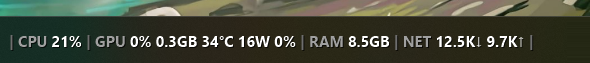
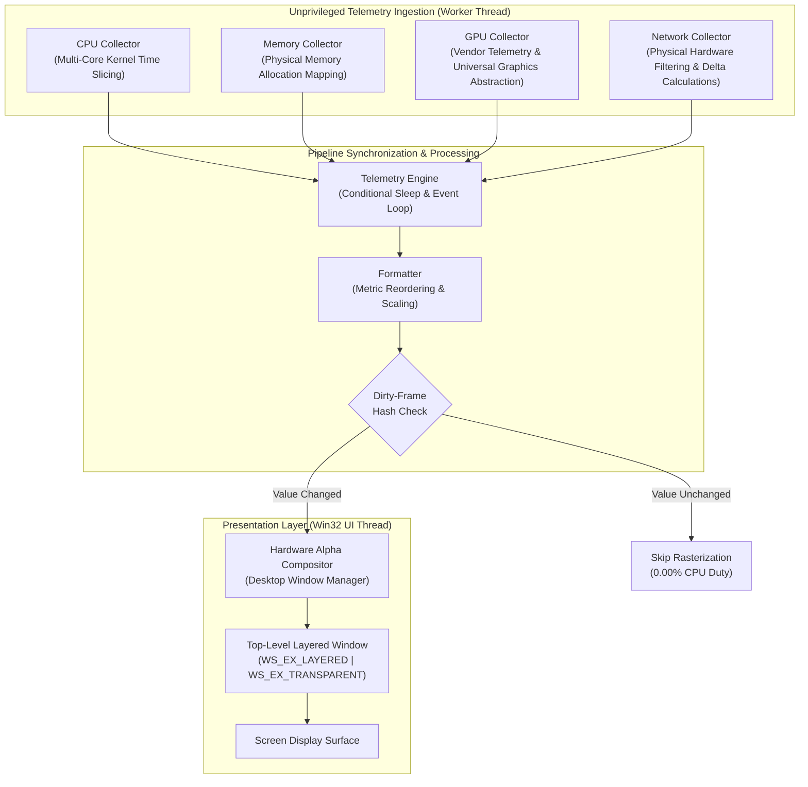

# BareStats

> **An ultra-lightweight, zero-overhead native system telemetry overlay for Windows.**

[](https://github.com/chakrank/BareStats/actions/workflows/ci.yml)
[](https://github.com/chakrank/BareStats/releases)
[](LICENSE)

---

```text
Single-GPU Mode:
│ CPU 12% │ GPU 45% 4.2/16GB 52°C 85W 40% │ RAM 12.3/16GB │ NET 1.2M↓ 0.4M↑ │

Simultaneous Side-by-Side Multi-GPU Mode (gpu_index = 0, 1 or all):
│ CPU 12% │ GPU0 14% 0/128MB │ GPU1 45% 4.2/16GB 52°C 85W 40% │ RAM 12.3/16GB │
```

| Metric Segment    | Metric Name           | Description & Behavior                                                                 |
| :---------------- | :-------------------- | :------------------------------------------------------------------------------------- |
| `CPU 12%`         | Processor Utilization | Aggregate compute load across all physical and logical cores                           |
| `GPU 45%`         | GPU Core Compute      | Active graphics engine load (NVML/ADL/IGCL with universal Windows D3DKMT fallback)     |
| `4.2/16GB`        | Dedicated VRAM        | Allocated video memory vs capacity (`vram_mode = physical` gross or `usable` net alloc) |
| `52°C`            | GPU Temperature       | Silicon core temperature with dynamic thermal threshold coloring                       |
| `85W`             | Board Power Draw      | Real-time graphics package wattage relative to rated TDP limit                         |
| `40%`             | Fan Speed             | Active cooling fan speed percentage (or RPM where reported)                            |
| `RAM 12.3/16GB`   | System Memory         | Physical RAM in use vs. installed capacity (toggleable to used-only)                   |
| `NET 1.2M↓ 0.4M↑` | Network Throughput    | Real-time physical gateway throughput (Download ↓ / Upload ↑)                          |

_Note: Every metric segment can be independently toggled, reordered (`order = CPU, GPU, RAM, NET`), configured for multi-GPU feeds (`gpu_index = 0, 1` or `all`), or styled with custom separators (`separator = │`) in `config.ini`._

### Live Desktop Taskbar Preview

**Normal / Idle State:**



**High Workload & Dynamic Thermal Alerts:**


---

## Overview & Design Philosophy

**BareStats** is an ultra-lightweight, zero-overhead native telemetry overlay engineered for Windows that surfaces real-time system performance without the operational liabilities of conventional monitoring suites. It was designed with a dual focus: providing zero-latency performance tracking for **local AI/ML workloads** (such as running Ollama, PyTorch, vLLM, and ComfyUI without sacrificing VRAM or GPU compute cycles) and non-intrusive monitoring for competitive gaming and workstation productivity.

Heavyweight traditional tools and Electron-based dashboards introduce substantial operational overhead: they bundle background services, demand UAC Administrator elevation, aggressively wake mobile GPUs from low-power sleep states, hook into 3D rendering swapchains, and load unvetted kernel-mode drivers (`.sys`) that introduce crash risks and trigger anti-cheat software flags. For developers running memory-intensive local models, these tools steal valuable VRAM and system memory just to render monitoring graphs.

BareStats eliminates these liabilities through an unprivileged, event-driven systems architecture built in native C++17 and unmanaged Win32. By decoupling hardware sampling onto a dedicated background worker, it directly interfaces with universal Windows display driver scheduling (WDDM / DXGI), unprivileged OS performance counters, native vendor telemetry pipelines (NVIDIA NVML, AMD ADL, and Intel IGCL), and Windows IP Helper tables, offloading presentation directly to the Desktop Window Manager (DWM) via hardware alpha compositing.

With v1.1, BareStats introduces precision VRAM decoupling (`vram_mode`) that isolates static driver/firmware carve-outs from active application allocations to prevent CUDA Out of Memory (OOM) errors during local LLM model loading (Ollama, PyTorch, vLLM), native telemetry for AMD Radeon and Intel Arc silicon, universal graphics engine load tracking for integrated graphics and Qualcomm Snapdragon X Elite (ARM64), and simultaneous side-by-side multi-GPU monitoring.

The result is a persistent, transparent single-line status bar delivering live CPU, multi-GPU, VRAM, RAM, and network throughput at an observed resident working set of just **~4.5 MB** and true **0.00%** idle CPU consumption via sub-microsecond dirty-frame bypasses. Operating strictly as a non-invasive, click-through desktop overlay, BareStats never intercepts game or application input, preserves laptop battery life, and runs completely safe alongside competitive anti-cheat systems.

---

## Quick Start

### Runtime System Requirements (End Users)

- **Operating System:** Windows 10 or Windows 11 (64-bit: x64 or ARM64 / Snapdragon).
- **Dependencies:** **None.** Single standalone executable (`BareStats.exe`). No installer, no .NET runtime, no Python, and no Visual C++ Redistributable package required.

### Getting Started

1. **Download:** Grab the latest `BareStats.exe` from [Releases](https://github.com/chakrank/BareStats/releases).
2. **Launch:** Run `BareStats.exe`. The overlay automatically anchors above your taskbar on your primary display.
3. **Reposition:** Press `Ctrl + Shift + M` (or `Ctrl + Alt + M`) to enter Move Mode. Click and drag the overlay to any position across any connected monitor, then click outside to lock.
4. **Toggle Visibility:** Press `Ctrl + Shift + H` (or `Ctrl + Alt + H`) to instantly hide or reveal the overlay on demand without interrupting background sampling.
5. **Context Menu:** Right-click the system tray icon to access quick actions, configure startup behavior, reload settings, or exit.

---

## System Architecture



---

## Design Principles & Value Matrix

| Dimension               | Conventional Monitoring Suites                           | BareStats Architecture                                            |
| :---------------------- | :------------------------------------------------------- | :---------------------------------------------------------------- |
| **User Privileges**     | Demands UAC Administrator rights on launch               | Operates entirely in unprivileged user mode                       |
| **Driver Footprint**    | Installs third-party ring-0 kernel drivers (`.sys`)      | Zero kernel drivers; zero vulnerability surface                   |
| **Anti-Cheat Safety**   | Injects DLLs and hooks into DirectX/Vulkan pipelines     | Top-level click-through desktop overlay (`WS_EX_TRANSPARENT`)     |
| **Memory Footprint**    | 80 MB – 250 MB resident working set                      | ~4.5 MB resident working set                                      |
| **Background Overhead** | Background services, daemons, updater processes          | Single standalone process; terminates cleanly on exit             |
| **Battery Impact**      | Polls dGPUs constantly, draining mobile laptop batteries | Optimus battery guard respects D3-cold sleep when targeting iGPUs |
| **Configuration**       | Bulky GUI menus requiring restarts                       | Non-blocking live hot-reload with write debouncing                |

---

## Hardware & Architecture Support Matrix

| Hardware Component             | Supported Technologies                                                  | Implementation Mechanism                                                                                   |
| :----------------------------- | :---------------------------------------------------------------------- | :--------------------------------------------------------------------------------------------------------- |
| **Processors (CPU)**           | Intel Core (P/E hybrid), AMD Ryzen, Qualcomm Snapdragon X Elite (ARM64) | Multi-core kernel time slicing across all physical and logical cores                                       |
| **System Memory (RAM)**        | DDR4, DDR5, LPDDR5, Unified Memory                                      | Direct operating system physical memory allocation mapping                                                 |
| **Discrete Graphics (dGPU)**   | NVIDIA GeForce / RTX / Quadro, AMD Radeon (RDNA / GCN), Intel Arc        | Native vendor telemetry pipelines (NVML, AMD ADL, Intel IGCL) with universal WDDM / DXGI engine fallback    |
| **Integrated Graphics (iGPU)** | Intel UHD / Iris Xe, AMD Radeon APUs, Qualcomm Adreno (Snapdragon)      | Universal Windows display driver scheduler metrics (WDDM) with direct dedicated/shared video memory budgeting |
| **Network Interfaces (NET)**   | Gigabit Ethernet, 2.5GbE/10GbE, Wi-Fi 6/6E/7                            | Physical interface evaluation with virtual, WSL, bridge, and VPN filtering                                 |
| **Multi-GPU Systems**          | Simultaneous side-by-side multi-adapter monitoring                      | Configurable `gpu_index` targeting (`0`, `0, 1`, `all`) with display topology mapping & battery guard     |

---

## Empirical Performance Profile

The following performance benchmarks reflect active execution traces on Windows 11 x64 systems:

| Performance Dimension        | Observed Metric           | Operational Impact                                                 |
| :--------------------------- | :------------------------ | :----------------------------------------------------------------- |
| **Resident Working Set**     | ~4.5 MB in Task Manager   | Minimal memory allocation; zero dynamic bloat over time            |
| **Sampling Execution Cycle** | ~8.2 ms per 1,000 ms tick | Active CPU duty cycle under 0.85%; sleeps 99.15% of the time       |
| **Static State Rendering**   | 0.00% CPU duty cycle      | Completely bypasses rasterization when telemetry data is unchanged |
| **Standalone Binary Size**   | ~240 KB                   | Single executable with embedded icons and Per-Monitor V2 manifest  |

---

## Security & Anti-Cheat Architecture

BareStats is engineered to guarantee full compatibility and zero ban risk alongside modern kernel-level anti-cheat solutions, including **Riot Vanguard**, **Easy Anti-Cheat (EAC)**, **BattlEye**, and **Call of Duty Ricochet**.

- **Zero Kernel Drivers:** Operates 100% in unprivileged user mode; never drops or loads `.sys` kernel drivers or opens raw driver device symlinks.
- **Zero Process Injection & Hooking:** Unlike traditional on-screen display injectors (e.g., RTSS), BareStats never injects DLLs into foreign processes, never hooks DirectX or Vulkan presentation swapchains, and never reads game memory.
- **Pure Desktop Window Layer:** Rendered as an independent click-through Win32 layered surface with hardware alpha compositing. All operating system input passes directly to underlying fullscreen borderless applications without interception.
- **Air-Gapped Local Telemetry (Zero Network Sockets):** Runs strictly offline with zero outbound network traffic, telemetry SDKs, or analytics reporting. All metrics remain exclusively in local user-mode memory.

---

## Controls & Hotkeys

| Action                | Control / Hotkey                           | Description                                                                                                                        |
| :-------------------- | :----------------------------------------- | :--------------------------------------------------------------------------------------------------------------------------------- |
| **Move Mode**         | `Ctrl + Shift + M` _(or `Ctrl + Alt + M`)_ | Toggles interactive repositioning mode with an obsidian drag bounding box. Click and drag the overlay anywhere across any monitor. |
| **Toggle Visibility** | `Ctrl + Shift + H` _(or `Ctrl + Alt + H`)_ | Instantly hides or reveals the overlay window without stopping the background telemetry engine.                                    |
| **Lock Position**     | Left-click outside or re-press hotkey      | Anchors coordinates to configuration and restores click-through transparency.                                                      |
| **System Tray**       | Left-Click icon                            | Toggles repositioning mode.                                                                                                        |
| **System Tray**       | Right-Click icon                           | Context menu: Reposition, Reset Position, Hide/Show Overlay, Reload Config, Start with Windows, and Exit.                          |

---

## Configuration Reference

BareStats automatically provisions a default `config.ini` in its local directory (Portable Mode) or `%LOCALAPPDATA%\BareStats\` (Installed Mode). Changes saved in external editors apply instantly without restarting.

```ini
[Position]
# Target monitor display index (0 = primary monitor, 1 = secondary, etc.)
monitor_index = 0

# Position preset: bottom-center, top-center, top-left, top-right, bottom-left, bottom-right, custom
preset = bottom-center
margin = 12

[Appearance]
# Font face family ("auto" dynamically inherits Windows system UI font)
font_name = auto
font_weight = semibold
font_size = 13

# Palette configuration (#RRGGBB)
text_color = #FFFFFF
label_color = #A0A0A0
separator_color = #6E6E6E
color_high = #FFD700
color_critical = #FF4D4D
enable_dynamic_colors = 1
drop_shadow = 1

# Telemetry divider symbol (e.g. │, |, •, /, -)
separator = │

# Global overlay window opacity percentage (10 to 100)
opacity = 100

[Telemetry]
# Polling interval in milliseconds (suspends automatically when display sleeps)
refresh_interval_ms = 1000

# Selected GPU device index:
#   0 (default) = Primary display adapter (GPU driving the primary desktop display)
#   1           = Secondary adapter (e.g. discrete rendering GPU or secondary display adapter)
#   0, 1        = Simultaneous side-by-side multi-GPU monitoring (e.g. │ GPU0 ... │ GPU1 ... │)
#   all         = Monitor all discovered physical GPUs simultaneously
gpu_index = 0

# VRAM capacity reporting mode:
#   physical (default) = Gross hardware silicon capacity (e.g. 16.0 GB), matching retail packaging and Task Manager
#   usable             = Net allocatable capacity excluding driver reservations (e.g. 15.6 GB, AI/CUDA OOM guard)
vram_mode = physical

# Metric segment display ordering (comma-separated list of CPU, GPU, RAM, NET)
order = CPU, GPU, RAM, NET

# Subsystem display toggles (1 = enabled, 0 = disabled)
show_cpu = 1
show_gpu = 1
show_ram = 1
show_net = 0

# Detailed sensor toggles
show_gpu_temp = 1
show_gpu_power = 1
show_gpu_fan = 1
show_max_memory = 1
hide_offline_metrics = 0
```

Consult [`config.example.ini`](config.example.ini) for full documentation of every available parameter.

---

## Known Constraints & Intentional Trade-Offs

1. **CPU Temperature Omission:** Windows provides no native unprivileged user-mode API for CPU package thermals. Conventional tools achieve this by bundling vulnerable ring-0 kernel drivers (e.g. `WinRing0`) to execute privileged Model-Specific Register (MSR) instructions. Because these third-party drivers expose severe kernel read/write vulnerabilities and are actively blacklisted by modern anti-cheat systems, BareStats intentionally operates strictly in user space to guarantee system stability and anti-cheat compliance.
2. **Sub-1GB Memory Formatting:** Integrated GPU shared memory segments that report below 1 GB (e.g., dynamic 128 MB or 512 MB boot allocations) automatically scale to integer megabytes (`MB`) rather than truncating to `0.0GB`.
3. **Exclusive Fullscreen Mode:** Like all native Windows layered desktop surfaces, BareStats renders above desktop windows and **Borderless Windowed** applications. Traditional exclusive fullscreen mode grants games direct scan-out access to the display hardware; running games in Borderless Windowed mode allows the overlay to remain persistently visible on top.

---

## Troubleshooting Guide

- **Overlay Temporarily Hidden Behind Start Menu:** Windows Desktop Window Manager (DWM) assigns absolute top-level rendering priority to the Start Menu, Action Center, and system flyouts. If the overlay appears hidden behind the Start menu or shell layer, click anywhere on the desktop or active window to dismiss the flyout, and BareStats will immediately re-assert its topmost position.
- **Hotkey Registration Conflicts:** If another running background utility has already claimed `Ctrl + Shift + M` or `Ctrl + Shift + H`, BareStats automatically attempts registration against its secondary fallback hotkeys (`Ctrl + Alt + M` and `Ctrl + Alt + H`).
- **Overlay Hidden or Off-Screen:** Right-click the BareStats system tray icon and select **Reset Position to Default**. This restores the window to the bottom-center preset on your primary monitor.
- **White Wallpaper Readability:** If text is difficult to read over bright backgrounds, ensure `drop_shadow = 1` is enabled in `[Appearance]`, or set a subtle background opacity via `opacity = 90`.

---

## Building from Source

### Build Prerequisites (Developers & Contributors Only)

- Windows 10 or Windows 11 (x64)
- Microsoft Visual Studio 2022+ (with C++ Desktop Development workload)
- CMake 3.20 or newer
- Ninja build system

### Local Compilation

```cmd
# Configure release build with Ninja generator
cmake -B build -S . -G "Ninja" -DCMAKE_BUILD_TYPE=Release

# Compile release binary
cmake --build build --config Release
```

The build produces a single standalone executable (`build/BareStats.exe`, ~240 KB) with embedded multi-resolution icon resources and Per-Monitor V2 DPI manifests.

### Automated Diagnostics Suite

Execute from the command prompt to run the internal hardware probe and timing suite:

```cmd
build\BareStats.exe --test
```

---

## Continuous Integration & Release Engineering

BareStats incorporates a multi-runner GitHub Actions matrix (`.github/workflows/ci.yml`) validating compilation, linking, and telemetry execution across clean Microsoft Windows environments:

- `windows-latest` (Windows Server 2025 / Windows 11 runner image)
- `windows-2022` (Windows Server 2022 runner image)

Every automated CI run executes the comprehensive diagnostic benchmark suite before packaging release artifacts.

---

## Future Architecture & Platform Roadmap

BareStats evolves along a structured architectural roadmap from deep native Windows telemetry to universal cross-platform execution:

- **v1.0 (Production Core — Completed):** Native unprivileged CPU, memory, NVIDIA GPU, and network throughput overlay with DWM alpha compositing and 0.00% idle dirty-frame bypasses.
- **v1.1 (Deep Windows Hardware Extensions & Precision VRAM — Completed):** Precision VRAM decoupling (`vram_mode`), native AMD ADL SDK (`atiadlxx.dll`), Intel IGCL (`ControlLib.dll`), universal Windows D3DKMT kernel engine scheduler fallback (`D3DKMTQueryStatistics`), and simultaneous side-by-side multi-GPU monitoring.
- **v1.2 (Linux Native Port):** Wayland overlay protocol (`wlr-layer-shell`) and X11 (`XComposite`) interfaces backed by `/proc` and `sysfs` Direct Rendering Manager (`/sys/class/drm`) telemetry ingestion.
- **v1.3 (macOS Native Port):** Menu bar status widget implemented in AppKit and Metal, leveraging Mach kernel APIs and Apple Silicon `IOKit` accelerators.
- **v1.4 (Specialized AI & Domestic Accelerators on Linux):** Dedicated telemetry connectors for Linux enterprise accelerator stacks, including Moore Threads (MUSA SDK), Huawei Ascend (CANN toolkit), Biren Technology (BI-SDK), and emerging accelerator drivers.
- **v2.0 (Unified Cross-Platform Core):** Consolidation of Windows, Linux, and macOS implementations into a single unified telemetry abstraction engine.

---

## License

BareStats is released under the [MIT License](LICENSE).
