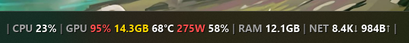
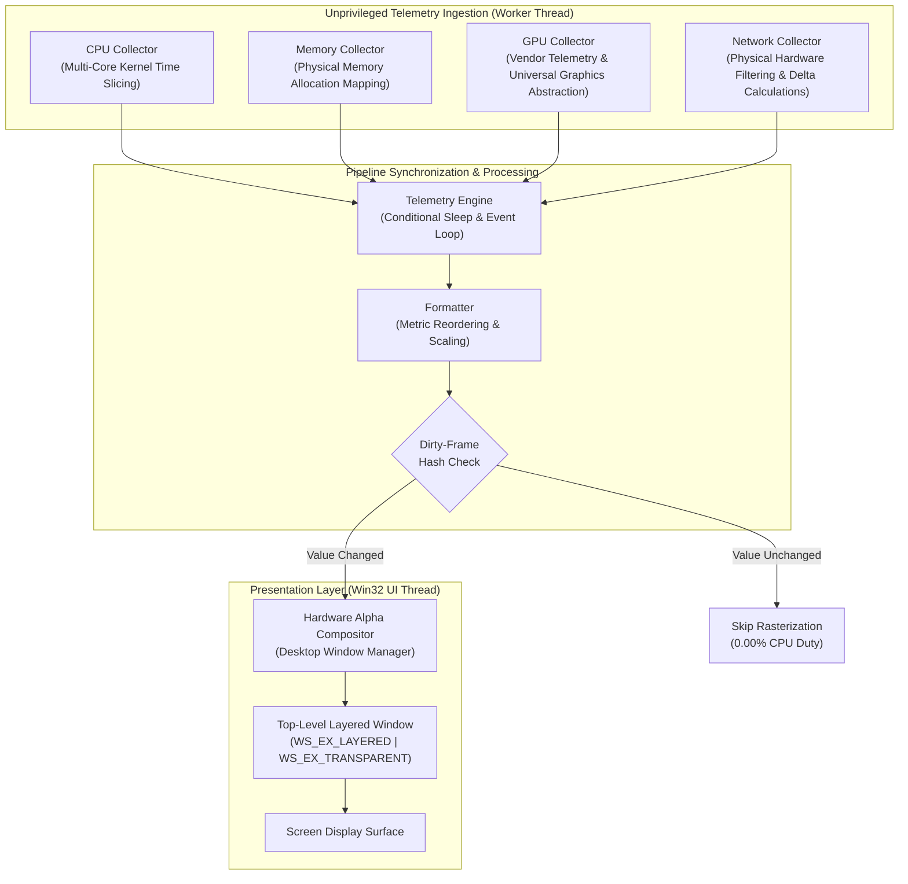

# BareStats

> **An ultra-lightweight, zero-overhead native system telemetry overlay for macOS, Linux, and Windows.**

[](https://github.com/chakrank/BareStats/actions/workflows/ci.yml)
[](https://github.com/chakrank/BareStats/releases)
[](LICENSE)

---

```text
Single-GPU Mode:
│ CPU 12% │ GPU 45% 4.2/16GB 52°C 85W 40% │ RAM 12.3/16GB │ NET 1.2M↓ 0.4M↑ │

Simultaneous Side-by-Side Multi-GPU Mode (gpu_index = 0, 1 or all):
│ CPU 12% │ GPU0 14% 0/128MB │ GPU1 45% 4.2/16GB 52°C 85W 40% │ RAM 12.3/16GB │
```

| Metric Segment    | Metric Name           | Description & Behavior                                                                 |
| :---------------- | :-------------------- | :------------------------------------------------------------------------------------- |
| `CPU 12%`         | Processor Utilization | Aggregate compute load across all physical and logical cores                           |
| `GPU 45%`         | GPU Core Compute      | Active graphics engine load (NVML/ADL/IGCL with universal Windows D3DKMT and Linux DRM fallback) |
| `4.2/16GB`        | Dedicated VRAM        | Allocated video memory vs capacity (`vram_mode = physical` gross or `usable` net alloc) |
| `52°C`            | GPU Temperature       | Silicon core temperature with dynamic thermal threshold coloring                       |
| `85W`             | Board Power Draw      | Real-time graphics package wattage relative to rated TDP limit                         |
| `40%`             | Fan Speed             | Active cooling fan speed percentage (or RPM where reported)                            |
| `RAM 12.3/16GB`   | System Memory         | Physical RAM in use vs. installed capacity (toggleable to used-only)                   |
| `NET 1.2M↓ 0.4M↑` | Network Throughput    | Real-time physical gateway throughput (Download ↓ / Upload ↑)                          |

_Note: Every metric segment can be independently toggled, reordered (`order = CPU, GPU, RAM, NET`), configured for multi-GPU feeds (`gpu_index = 0, 1` or `all`), or styled with custom separators (`separator = │`) in `config.ini`._

### Live Desktop Taskbar Preview

**Normal / Idle State:**


**High Workload & Dynamic Thermal Alerts:**



---

## Overview & Design Philosophy

**BareStats** is an ultra-lightweight, zero-overhead native telemetry overlay engineered for macOS, Linux, and Windows that surfaces real-time system performance without the operational liabilities of conventional monitoring suites. It was designed with a dual focus: providing zero-latency performance tracking for **local AI/ML workloads** (such as running Ollama, PyTorch, vLLM, and ComfyUI without sacrificing VRAM or GPU compute cycles) and non-intrusive monitoring for competitive gaming and workstation productivity.

Heavyweight traditional tools and Electron-based dashboards introduce substantial operational overhead: they bundle background services, demand root / Administrator elevation, aggressively wake mobile GPUs from low-power sleep states, hook into 3D rendering swapchains, and load unvetted kernel-mode drivers that introduce crash risks. For developers running memory-intensive local models, these tools steal valuable VRAM and system memory just to render monitoring graphs.

BareStats eliminates these liabilities through an unprivileged, event-driven systems architecture built in native C++17 and Objective-C++. By decoupling hardware sampling onto a dedicated background worker, it directly interfaces with universal display driver scheduling (Metal and IOKit on macOS; WDDM/DXGI on Windows; Linux Direct Rendering Manager `/sys/class/drm` and `/sys/class/hwmon`), unprivileged OS performance counters (Mach kernel `host_statistics64` on macOS; `/proc/stat`, `/proc/meminfo`, `/proc/net/dev` on Linux), native vendor telemetry pipelines (Apple Silicon unified memory telemetry, NVIDIA NVML, AMD ADL, and Intel IGCL), and network routing tables, offloading presentation directly to the native compositor (Cocoa/AppKit floating `NSPanel` with CoreGraphics/CoreText on macOS; Desktop Window Manager via hardware alpha compositing on Windows; Cairo with X11 / XWayland shape masking on Linux).

With v1.3, BareStats achieves complete cross-platform parity across macOS, Linux, and Windows: native macOS menu bar status integration (`NSStatusItem`), an interactive Move Mode with click-outside exit, smooth mathematical Ease-Out Quadratic rolling number startup animations, single-instance mutex enforcement, multi-window component islands (`grid_mode = islands`) with OS-level click-through between slots, and native distribution packaging across Drag-and-Drop `.dmg`, Ubuntu/Debian, Fedora/RHEL, openSUSE, Arch Linux, AppImage, and portable tarballs.

The result is a persistent, transparent single-line status bar delivering live CPU, multi-GPU, VRAM, RAM, and network throughput at an observed resident working set of just **~4.5 MB** on Windows (and ~2.9 MB native engine heap on Linux and macOS) with true **0.00%** idle CPU consumption via sub-microsecond dirty-frame bypasses. Operating strictly as a non-invasive, click-through desktop overlay, BareStats never intercepts application or game input, preserves laptop battery life, and runs completely safe alongside competitive anti-cheat systems.

---

## Quick Start & Installation

### Supported Operating Systems

- **Linux:** Any modern x86_64 distribution running X11 or XWayland (Ubuntu, Debian, Fedora, openSUSE, Arch Linux, Manjaro, Linux Mint, Pop!_OS, RHEL/Rocky).
  - Unprivileged: Reads `/proc/stat`, `/proc/meminfo`, `/proc/net/dev`, `/sys/class/drm`, `/sys/class/hwmon`, and NVML for NVIDIA hardware.
  - Dependencies: Standard system libraries (`libcairo2`, `libx11-6`, `libxfixes3`).
- **macOS:** macOS 11.0 (Big Sur) through macOS 15+ (Sequoia) on both **Apple Silicon (ARM64)** and **Intel (x86_64)** via Universal Binaries.
  - Unprivileged: Mach kernel (`host_statistics64`), Metal API (`MTLCopyAllDevices`), unprivileged IOKit `IOAccelerator`, and BSD sockets `getifaddrs`.
  - Dependencies: None. Standard system frameworks (Cocoa, Metal, IOKit, CoreGraphics, CoreText, CoreFoundation). Distributed as a standalone Application Bundle (`BareStats.app`) and Drag-and-Drop `.dmg`.
- **Windows:** Windows 10 or Windows 11 (64-bit: x64 or ARM64 / Snapdragon).
  - Dependencies: None. Single standalone executable (`BareStats.exe`). No installer, no .NET runtime, no Python, and no Visual C++ Redistributable required.

---

### Linux Installation by Distribution

Pre-compiled distribution packages and cryptographic verification manifests are available on the [Releases](https://github.com/chakrank/BareStats/releases) page.

#### Ubuntu / Debian / Linux Mint / Pop!_OS (`.deb`)

Download `barestats_1.3.0_amd64.deb`:

```bash
# Install package
sudo apt install ./barestats_1.3.0_amd64.deb

# Launch BareStats
barestats

# Uninstall
sudo apt remove barestats
```

#### Fedora / RHEL / CentOS / Rocky Linux (`.rpm`)

Download `barestats-1.3.0-1.x86_64.rpm`:

```bash
# Install package
sudo dnf install ./barestats-1.3.0-1.x86_64.rpm

# Launch BareStats
barestats

# Uninstall
sudo dnf remove barestats
```

#### openSUSE (Tumbleweed / Leap) (`.rpm`)

Download `barestats-1.3.0-1.x86_64.rpm`:

```bash
# Install package
sudo zypper install ./barestats-1.3.0-1.x86_64.rpm

# Launch BareStats
barestats

# Uninstall
sudo zypper remove barestats
```

#### Arch Linux / Manjaro / EndeavourOS (`.pkg.tar.zst`)

Download `barestats-1.3.0-1-x86_64.pkg.tar.zst`:

```bash
# Install package
sudo pacman -U ./barestats-1.3.0-1-x86_64.pkg.tar.zst

# Launch BareStats
barestats

# Uninstall
sudo pacman -R barestats
```

#### Universal AppImage (All Linux Distributions)

Download `BareStats-1.3.0-x86_64.AppImage`:

```bash
# Make executable and run
chmod +x BareStats-1.3.0-x86_64.AppImage
./BareStats-1.3.0-x86_64.AppImage
```

#### Universal Tarball (Portable Archive with Installer)

Download `barestats-1.3.0-linux-x86_64.tar.gz`:

```bash
# Extract archive
tar -xzf barestats-1.3.0-linux-x86_64.tar.gz
cd barestats-1.3.0-linux-x86_64

# System-wide install (binary, .desktop launcher, icons, AppStream metadata)
sudo ./install.sh

# Or install to custom prefix (e.g. ~/.local)
PREFIX=~/.local ./install.sh

# To uninstall
sudo ./uninstall.sh
```

#### Standalone Raw ELF Executable

Download `barestats-linux-x86_64`:

```bash
chmod +x barestats-linux-x86_64
./barestats-linux-x86_64
```

---

### macOS Getting Started

1. **Download:** Grab the latest `barestats-1.3.0-macOS.dmg` (or universal application bundle) from [Releases](https://github.com/chakrank/BareStats/releases).
2. **Install:** Double-click the `.dmg` file and drag **BareStats** into your `/Applications` directory.
3. **Launch:** Open `BareStats` from Applications or Spotlight. BareStats runs as an accessory menu bar utility (`LSUIElement = true`) with a native light/dark template status bar icon.
4. **Reposition:** Click the menu bar icon and select **Reposition Mode** (or run `BareStats --move`). Click and drag the overlay anywhere across your screens, then press `Esc` or click outside to lock coordinates.
5. **CLI Integration:** Send commands directly via local IPC socket:
   - `/Applications/BareStats.app/Contents/MacOS/BareStats --toggle` to hide or show the overlay.
   - `/Applications/BareStats.app/Contents/MacOS/BareStats --move` to engage interactive repositioning.
   - `/Applications/BareStats.app/Contents/MacOS/BareStats --preset TopRight` to cycle corner positions.
   - `/Applications/BareStats.app/Contents/MacOS/BareStats --reload` to re-read configuration.
   - `/Applications/BareStats.app/Contents/MacOS/BareStats --quit` to exit cleanly.

---

### Windows Getting Started

1. **Download:** Grab the latest `BareStats.exe` (or `BareStats-v1.3.0-Windows-x64.zip`) from [Releases](https://github.com/chakrank/BareStats/releases).
2. **Launch:** Run `BareStats.exe`. The overlay automatically anchors above your taskbar on your primary display.
3. **Reposition:** Press `Ctrl + Shift + M` (or `Ctrl + Alt + M`) to enter Move Mode. Click and drag the overlay to any position across any connected monitor, then click outside to lock.
4. **Toggle Visibility:** Press `Ctrl + Shift + H` (or `Ctrl + Alt + H`) to instantly hide or reveal the overlay on demand without interrupting background sampling.
5. **Context Menu:** Right-click the system tray icon to access quick actions, configure startup behavior, reload settings, or exit.

---

## System Architecture



---

## Design Principles & Value Matrix

| Dimension               | Conventional Monitoring Suites                           | BareStats Architecture                                            |
| :---------------------- | :------------------------------------------------------- | :---------------------------------------------------------------- |
| **User Privileges**     | Demands UAC Administrator rights on launch               | Operates entirely in unprivileged user mode                       |
| **Driver Footprint**    | Installs third-party ring-0 kernel drivers (`.sys`)      | Zero kernel drivers; zero vulnerability surface                   |
| **Anti-Cheat Safety**   | Injects DLLs and hooks into DirectX/Vulkan pipelines     | Top-level click-through desktop overlay (`WS_EX_TRANSPARENT`)     |
| **Memory Footprint**    | 80 MB – 250 MB resident working set                      | ~4.5 MB resident working set                                      |
| **Background Overhead** | Background services, daemons, updater processes          | Single standalone process; terminates cleanly on exit             |
| **Battery Impact**      | Polls dGPUs constantly, draining mobile laptop batteries | Optimus battery guard respects D3-cold sleep when targeting iGPUs |
| **Configuration**       | Bulky GUI menus requiring restarts                       | Non-blocking live hot-reload with write debouncing                |

---

## Hardware & Architecture Support Matrix

| Hardware Component             | Supported Technologies                                                  | Implementation Mechanism                                                                                   |
| :----------------------------- | :---------------------------------------------------------------------- | :--------------------------------------------------------------------------------------------------------- |
| **Processors (CPU)**           | Intel Core (P/E hybrid), AMD Ryzen, Qualcomm Snapdragon X Elite (ARM64) | Multi-core kernel time slicing across all physical and logical cores                                       |
| **System Memory (RAM)**        | DDR4, DDR5, LPDDR5, Unified Memory                                      | Direct operating system physical memory allocation mapping                                                 |
| **Discrete Graphics (dGPU)**   | NVIDIA GeForce / RTX / Quadro, AMD Radeon (RDNA / GCN), Intel Arc        | Native vendor telemetry pipelines (NVML, AMD ADL, Intel IGCL) with universal WDDM / DXGI engine fallback    |
| **Integrated Graphics (iGPU)** | Intel UHD / Iris Xe, AMD Radeon APUs, Qualcomm Adreno (Snapdragon)      | Universal Windows display driver scheduler metrics (WDDM) with direct dedicated/shared video memory budgeting |
| **Network Interfaces (NET)**   | Gigabit Ethernet, 2.5GbE/10GbE, Wi-Fi 6/6E/7                            | Physical interface evaluation with virtual, WSL, bridge, and VPN filtering                                 |
| **Multi-GPU Systems**          | Simultaneous side-by-side multi-adapter monitoring                      | Configurable `gpu_index` targeting (`0`, `0, 1`, `all`) with display topology mapping & battery guard     |

---

## Empirical Performance Profile

| Performance Dimension | Windows (Observed) | Linux (Observed) | Operational Impact |
| :--- | :--- | :--- | :--- |
| **Engine Working Memory** | ~4.5 MB (Private Working Set) | ~2.9 MB (Engine Heap) | Minimal memory allocation; zero dynamic bloat over time |
| **System Monitor Reported** | ~4.5 MB in Task Manager | ~6–10 MB (sysfs) / ~34 MB (NVML RSS) / ~56 MB (with Tray Icon) | Reflects OS-specific reporting conventions (detailed below) |
| **Sampling Execution Cycle** | ~8.2 ms per 1,000 ms tick | ~6.5 ms per 1,000 ms tick | Active CPU duty cycle under 0.85%; sleeps > 99% of the time |
| **Static State Rendering** | 0.00% CPU duty cycle | 0.00% CPU duty cycle | Completely bypasses rasterization when telemetry data is unchanged |
| **Standalone Binary Size** | ~420 KB | ~578 KB (stripped ELF) | Single executable without external runtime dependencies |

### Memory Reporting: Linux vs. Windows Technical Breakdown

Users inspecting memory consumption in system monitors will notice different numbers between operating systems: Windows Task Manager reports **< 4.5 MB**, while Linux utilities (`top`, `ps`, GNOME System Monitor) report **~34 MB Resident Set Size (RSS)** on systems with NVIDIA GPUs, or **~56 MB RSS** if the optional Linux System Tray icon is enabled.

This difference is architectural, not application bloat:
- **Windows Task Manager** displays *Active Private Working Set* by default, which strictly measures private dirty committed pages and completely excludes shared operating system DLLs.
- **Linux System Monitors** report *Resident Set Size (RSS)*, which aggregates shared system libraries, driver scratch memory, and the application heap together.

Empirical profiling (`/proc/<pid>/smaps_rollup` on a running BareStats instance) reveals where memory resides on Linux:

#### Baseline Overlay Mode (`show_tray_icon = 0`, Default)
- **~15.3 MB — System Shared Libraries:** Read-only pages from standard desktop libraries (`libc`, `libcairo`, `libX11`, `libfreetype`, `libharfbuzz`, font tables) already resident in RAM for the desktop session and shared across all running applications.
- **~16.4 MB — NVIDIA Driver User-Space Arena:** On Linux, calling NVIDIA's `nvmlInit()` dynamically loads `libcuda.so` and immediately initializes a user-space DMA/CUDA client scratchpool in anonymous memory. (On Windows, NVIDIA places these buffers into kernel non-paged memory, which Task Manager does not charge to the user process).
- **~2.9 MB — BareStats Native Engine:** The actual memory consumed by BareStats's telemetry pipeline, Cairo surfaces, and configuration state—matching its ultra-lightweight profile on Windows. On systems without NVIDIA proprietary drivers (e.g. Intel or AMD using sysfs), BareStats typically reports only **~6 to 10 MB total RSS**.

#### Optional System Tray / AppIndicator Mode (`show_tray_icon = 1`)
- When the optional desktop tray icon is enabled (`show_tray_icon = 1`), BareStats dynamically loads the Linux desktop indicator stack (`libayatana-appindicator3` and `libgtk-3.so.0`).
- GTK3 and GIO initialize the desktop panel bridge, desktop theme styling (`gtk.gresource`), and DBus event workers, adding **~15.5 MB of shared library code pages** and **~6.5 MB of GTK internal state**, bringing reported RSS to **~56 MB** (or ~28 MB on systems without NVIDIA).
- **Core Philosophy Preserved:** Even with the tray active, **~31 MB** of the reported RSS consists of read-only shared desktop libraries already resident in memory for the desktop compositor, while BareStats's core engine heap remains strictly **~2.9 MB**. Compared to Electron- or Python-based desktop telemetry utilities (which regularly consume 250–500+ MB), BareStats remains orders of magnitude lighter and 100% native C++. Users seeking the absolute leanest baseline can leave `show_tray_icon = 0` to bypass GTK loading entirely.

---

## Security & Anti-Cheat Architecture

BareStats is engineered to guarantee full compatibility and zero ban risk alongside modern kernel-level anti-cheat solutions, including **Riot Vanguard**, **Easy Anti-Cheat (EAC)**, **BattlEye**, and **Call of Duty Ricochet**.

- **Zero Kernel Drivers:** Operates 100% in unprivileged user mode; never drops or loads `.sys` kernel drivers or opens raw driver device symlinks.
- **Zero Process Injection & Hooking:** Unlike traditional on-screen display injectors (e.g., RTSS), BareStats never injects DLLs into foreign processes, never hooks DirectX or Vulkan presentation swapchains, and never reads game memory.
- **Pure Desktop Window Layer:** Rendered as an independent click-through Win32 layered surface with hardware alpha compositing. All operating system input passes directly to underlying fullscreen borderless applications without interception.
- **Air-Gapped Local Telemetry (Zero Network Sockets):** Runs strictly offline with zero outbound network traffic, telemetry SDKs, or analytics reporting. All metrics remain exclusively in local user-mode memory.

---

## Controls, Hotkeys & Desktop Integration

### Cross-Platform Controls & Shortcuts

| Action | Linux Hotkey / Command | macOS Action / Command | Windows Hotkey / Tray | Description |
| :--- | :--- | :--- | :--- | :--- |
| **Move Mode** | `Ctrl + Shift + M` / `barestats --move` | Menu Bar Menu / `BareStats --move` | `Ctrl + Shift + M` / Tray Menu | Toggles interactive repositioning mode with an amber/gold bounding box. Click and drag anywhere across any monitor. Press `Esc` or click outside to lock. |
| **Toggle Visibility** | `Ctrl + Shift + H` / `barestats --toggle` | Menu Bar Menu / `BareStats --toggle` | `Ctrl + Shift + H` / Tray Menu | Instantly hides or reveals the overlay window without stopping background telemetry sampling. |
| **Lock / Exit Move** | Click outside or `Esc` | Click outside or `Esc` | Left-click outside or re-press hotkey | Anchors coordinates to configuration and restores click-through transparency. |
| **Preset Selection** | `barestats --preset <name>` | Menu Bar Presets submenu | Tray Menu / `config.ini` | Instantly moves the overlay to standard screen locations (`Bottom Center`, `Top Center`, `Top Left`, `Top Right`, etc.). |
| **Reload Config** | `barestats --reload` | Menu Bar Menu / `BareStats --reload` | Tray Menu / `config.ini` | Forces immediate reload of `config.ini`. |
| **Exit** | `barestats --quit` | Menu Bar Menu / `BareStats --quit` | Tray Menu Exit | Gracefully terminates BareStats and restores desktop state. |

### Linux Desktop Quick Actions & Panel Tray

- **Desktop Quick Actions:** On Linux desktop environments (GNOME, KDE Plasma, XFCE, Cinnamon), right-click the **BareStats** icon in your dock, dash, or application launcher to toggle visibility, enter reposition mode, reset position, or cycle corner presets.
- **Top Panel Tray Indicator:** When `show_tray_icon = 1` is configured, an unprivileged status indicator appears in the desktop panel with a full right-click context menu.

### macOS Menu Bar Status Item

BareStats runs unobtrusively in the macOS Menu Bar (`LSUIElement = true`) without cluttering the Dock or `Cmd+Tab` switcher:
- **Dynamic Template Icon:** Automatically adjusts contrast for Light Mode, Dark Mode, and dynamic wallpaper transitions.
- **Full Control Menu:**
  - **Reposition Mode:** Engage interactive mouse drag bounding box.
  - **Presets Submenu:** Select `Bottom Center`, `Top Center`, `Top Left`, `Top Right`, `Bottom Left`, or `Bottom Right`.
  - **Toggle Visibility:** Instantly hide or reveal overlay (`Ctrl + Opt + H`).
  - **Reload Configuration:** Apply manual `config.ini` changes on demand (`Ctrl + Opt + R`).
  - **Quit BareStats:** Clean termination (`Cmd + Q` or menu).

### Windows System Tray

- **Left-Click:** Toggles Move Mode.
- **Right-Click:** Context menu for Reposition, Reset Position, Hide/Show Overlay, Reload Config, Start with Windows, and Exit.

---

## Configuration Reference

BareStats automatically provisions a default `config.ini`:
- **Linux:** `~/.config/barestats/config.ini` (or alongside the binary in portable directory).
- **macOS:** `~/Library/Application Support/BareStats/config.ini` (with fallback to `~/.config/barestats/config.ini`).
- **Windows:** `%LOCALAPPDATA%\BareStats\config.ini` (or alongside `BareStats.exe` in portable mode).

Changes saved in external editors apply instantly without restarting (sub-second hot-reload).

```ini
[BareStats]
# Schema version for automated zero-overhead migrations
schema_version = 130

[Position]
# Target display index (0 = primary monitor, 1 = secondary)
monitor_index = 0

# Position preset: bottom-center, top-center, top-left, top-right, bottom-left, bottom-right, custom
preset = bottom-center

# Absolute screen coordinates in pixels (active when preset = custom)
custom_x = -1
custom_y = -1

# Monitor-relative coordinates (auto-saved during drag-and-drop repositioning)
custom_rel_x = -1
custom_rel_y = -1

# Edge margin in pixels
margin = 12

# Layout mode: horizontal, grid, or custom_grid
layout = horizontal

# Rendering engine for custom_grid: unified (single window) or islands (separate micro-surfaces)
grid_mode = unified

# Spacing between grid columns and rows in pixels
cell_gap = 16
row_gap = 4

# Maximum GPUs displayed per row when layout = grid
max_gpus_per_row = 2

# Custom matrix rows (active when layout = custom_grid; '.' or 'null' for blank cells; colspans supported)
# grid_row_1 = cpu | ram | net
# grid_row_2 = gpu0 | gpu1

[Appearance]
# Font face ("auto" dynamically inherits native system UI font)
font_name = auto
font_weight = semibold
font_size = 13

# Palette in hex (#RRGGBB)
text_color = #FFFFFF
label_color = #A0A0A0
separator_color = #6E6E6E
color_high = #FFD700
color_critical = #FF4D4D

# Dynamic threshold alerts and dark drop-shadow (1 = on, 0 = off)
enable_dynamic_colors = 1
drop_shadow = 1

# Telemetry segment divider symbol
separator = │

# Global overlay opacity percentage (10 to 100, hardware alpha-blended)
opacity = 100

# Show icon in Linux system tray / top panel indicator (1 = enabled, 0 = disabled)
show_tray_icon = 0

[Telemetry]
# Polling interval in milliseconds (suspends automatically when display sleeps)
refresh_interval_ms = 1000

# Selected GPU target: 0 (primary), 1 (secondary), "0, 1" (multi-GPU side-by-side), or "all"
gpu_index = 0

# VRAM reporting mode: physical (hardware silicon capacity) or usable (allocatable net)
vram_mode = physical

# Metric ordering (comma-separated list of CPU, GPU, RAM, NET)
order = CPU, GPU, RAM, NET

# Subsystem display toggles (1 = enabled, 0 = disabled)
show_cpu = 1
show_gpu = 1
show_ram = 1
show_net = 0

# Detailed sensor toggles
show_gpu_temp = 1
show_gpu_power = 1
show_gpu_fan = 1

# Memory format: 1 = used/total (12.3/16GB), 0 = used only (12.3GB)
show_max_memory = 1

# Hide offline hardware subsystems (1 = hide, 0 = show unavailable)
hide_offline_metrics = 0

# Optional per-adapter overrides:
# [GPU0]
# show_temp = 1
# show_power = 1
#
# [GPU1]
# show_temp = 0
# show_power = 0
```

Consult [`config.example.ini`](config.example.ini) for full documentation of every available parameter.

---

## Known Constraints & Intentional Trade-Offs

1. **CPU Temperature Omission:** Windows and macOS provide no public unprivileged user-mode API for CPU package thermals. Conventional tools achieve this by bundling vulnerable ring-0 kernel drivers (e.g. `WinRing0` on Windows) or requiring root daemons to execute privileged Model-Specific Register (MSR) / SMC instructions. Because these privileged drivers expose severe kernel read/write vulnerabilities and trigger anti-cheat bans, BareStats intentionally operates 100% in unprivileged user space to guarantee system stability and anti-cheat compliance. On Linux, `/sys/class/hwmon` is similarly omitted from default core sampling to maintain uniform unprivileged execution across heterogeneous motherboards.
2. **Sub-1GB Memory Formatting:** Integrated GPU shared memory segments that report below 1 GB (e.g., dynamic 128 MB or 512 MB boot allocations) automatically scale to integer megabytes (`MB`) rather than truncating to `0.0GB`.
3. **Exclusive Fullscreen Mode:** Like all native desktop layered surfaces across Windows, Linux, and macOS, BareStats renders above desktop windows and **Borderless Windowed** applications. Traditional exclusive fullscreen mode grants games direct exclusive scan-out access to display hardware; running games in Borderless Windowed mode allows the overlay to remain persistently visible on top.

---

## Troubleshooting Guide

- **Overlay Temporarily Hidden Behind Start Menu:** Windows Desktop Window Manager (DWM) assigns absolute top-level rendering priority to the Start Menu, Action Center, and system flyouts. If the overlay appears hidden behind the Start menu or shell layer, click anywhere on the desktop or active window to dismiss the flyout, and BareStats will immediately re-assert its topmost position.
- **Hotkey Registration Conflicts:** If another running background utility has already claimed `Ctrl + Shift + M` or `Ctrl + Shift + H`, BareStats automatically attempts registration against its secondary fallback hotkeys (`Ctrl + Alt + M` and `Ctrl + Alt + H`).
- **Overlay Hidden or Off-Screen:** Right-click the BareStats system tray icon and select **Reset Position to Default**. This restores the window to the bottom-center preset on your primary monitor.
- **White Wallpaper Readability:** If text is difficult to read over bright backgrounds, ensure `drop_shadow = 1` is enabled in `[Appearance]`, or set a subtle background opacity via `opacity = 90`.

---

## Building from Source

### Build Prerequisites

#### Linux (Ubuntu / Debian / Linux Mint)
```bash
sudo apt update
sudo apt install -y build-essential cmake ninja-build pkg-config \
  libx11-dev libxfixes-dev libxcomposite-dev libxrender-dev libcairo2-dev libwayland-dev rpm zstd
```

#### Linux (Fedora / RHEL / CentOS)
```bash
sudo dnf install -y gcc-c++ cmake ninja-build pkgconf-pkg-config \
  libX11-devel libXfixes-devel libXcomposite-devel libXrender-devel cairo-devel wayland-devel rpm-build
```

#### Linux (Arch Linux / Manjaro)
```bash
sudo pacman -S --needed base-devel cmake ninja pkgconf cairo libx11 libxfixes wayland
```

#### macOS (Apple Silicon & Intel)
- Xcode Command Line Tools (`xcode-select --install`)
- CMake 3.20 or newer
- Ninja build system (`brew install ninja`)

#### Windows (10 or 11)
- Microsoft Visual Studio 2022+ (with "Desktop development with C++" workload)
- CMake 3.20 or newer
- Ninja build system

---

### Local Compilation

#### Linux Compilation
```bash
# Configure release build with Ninja generator
cmake -B build -S . -G "Ninja" -DCMAKE_BUILD_TYPE=Release

# Compile release binary
cmake --build build --config Release

# Run automated unit tests
ctest --test-dir build --output-on-failure

# Execute internal hardware probe / diagnostics
build/barestats --test
```

To build all distribution release packages (`.deb`, `.rpm`, `.pkg.tar.zst`, `.tar.gz`, `AppImage`, and raw binary):
```bash
bash packaging/build_linux_packages.sh
```

#### macOS Compilation
```bash
# Automated Universal (arm64 + x86_64) application bundle & Drag-and-Drop .dmg package
./packaging/macos/build_macos.sh

# Or manual configuration via CMake:
cmake -B build -S . -G "Ninja" -DCMAKE_BUILD_TYPE=Release -DCMAKE_OSX_ARCHITECTURES="arm64;x86_64" -DBARESTATS_BUILD_TESTS=ON
cmake --build build --config Release
ctest --test-dir build --output-on-failure
cpack --config build/CPackConfig.cmake -G DragNDrop
```

#### Windows Compilation
```cmd
# Configure release build with Ninja generator
cmake -B build -S . -G "Ninja" -DCMAKE_BUILD_TYPE=Release

# Compile release binary
cmake --build build --config Release

# Run automated modular verification suite
python scripts/run_tests.py

# Execute internal hardware probe / diagnostics
build\BareStats.exe --test
```

To build the Windows release zip package and SHA-256 checksums:
```powershell
powershell -ExecutionPolicy Bypass -File packaging/windows/package_windows.ps1
```

---

## Continuous Integration & Verification Matrix

BareStats incorporates an automated GitHub Actions matrix (`.github/workflows/ci.yml`) validating compilation, linking, and packaging across clean environments:

- **Linux Build Runner:** `ubuntu-latest` with GCC / Clang, generating native `.deb`, `.rpm`, `.pkg.tar.zst`, `.tar.gz`, `.AppImage`, and raw ELF artifacts with cryptographic SHA-256 verification.
- **Containerized Multi-Distro Smoke Matrix:** Pre-compiled Linux packages are downloaded and verified inside clean, isolated Docker containers without recompilation:
  - **Ubuntu 24.04 (`ubuntu:24.04`)**: Verifies `.deb` installation, binary execution, and uninstallation.
  - **Debian 12 (`debian:bookworm`)**: Verifies Debian `.deb` package manager compatibility.
  - **Fedora Latest (`fedora:latest`)**: Verifies `.rpm` installation via `dnf` and dynamic library resolution.
  - **openSUSE Leap (`opensuse/leap:latest`)**: Verifies `.rpm` installation via `zypper`.
  - **Arch Linux (`archlinux:latest`)**: Verifies `.pkg.tar.zst` installation via `pacman` and rolling-release glibc compatibility.
  - **Universal Tarball & Raw Binary (`debian:bookworm-slim`)**: Verifies standalone ELF execution and automated `install.sh`/`uninstall.sh` POSIX shell operations.
- **macOS Build & Test Runner:** `macos-latest` (Apple Silicon) & `macos-13` (Intel x86_64) compiling Universal Binaries, executing native unit test suites, and generating signed Drag-and-Drop `.dmg` distribution archives.
- **Windows Build & Test Runner:** `windows-latest` & `windows-2022` with MSVC compiler, 35/35 automated unit tests, and CLI execution checks.

---

## Version History & Architectural Milestones

- **v1.0 (Production Core):** Native unprivileged CPU, memory, NVIDIA GPU, and network throughput overlay with DWM alpha compositing and 0.00% idle dirty-frame bypasses.
- **v1.1 (Deep Windows Hardware Extensions & Precision VRAM):** Precision VRAM decoupling (`vram_mode`), native AMD ADL SDK (`atiadlxx.dll`), Intel IGCL (`ControlLib.dll`), universal Windows D3DKMT kernel engine scheduler fallback (`D3DKMTQueryStatistics`), and simultaneous side-by-side multi-GPU monitoring.
- **v1.2 (Multi-GPU Grid Architecture, Component Island Micro-HWNDs & Per-Adapter Customization):** User-configurable multi-row grid presentation (`layout = horizontal | grid | custom_grid`), true mathematical matrix grid layouts with cell merging, isolated component island micro-HWND presentation architecture (`grid_mode = islands`) with Win+D resilience, asymmetric per-adapter configuration (`[GPU0]`, `[GPU1]`), and transparent hardware auto-introspection with zero-loss schema migration.
- **v1.3 (Cross-Platform Linux & macOS Parity):** Complete cross-platform desktop telemetry overlay with native Linux (Cairo/X11, `/proc`, sysfs) and macOS (Cocoa/AppKit, Metal, Mach kernel, IOKit) support, interactive Move Mode with outside-click exit, rolling number startup animations, component island mode (`grid_mode = islands`), single-instance mutex enforcement, and native distribution packaging (Drag-and-Drop `.dmg`, standalone App bundle, Ubuntu/Debian .deb, Fedora .rpm, openSUSE .rpm, Arch Linux .pkg.tar.zst, AppImage, and Universal Tarball).

---

## License

BareStats is released under the [MIT License](LICENSE).
